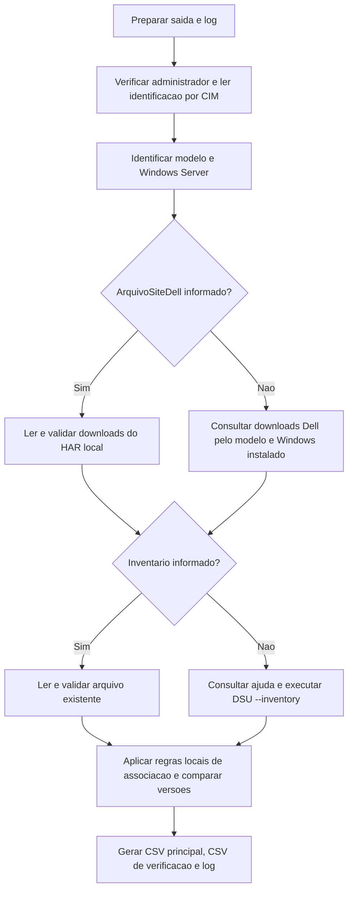

# Relatório local de firmware e drivers Dell PowerEdge

Script PowerShell para apoiar a análise de atualizações em servidores Dell PowerEdge com Windows Server. Compara versões instaladas com uma referência Dell e gera CSV, log e arquivos de diagnóstico. **Não instala atualizações nem reinicia o servidor.**

## Resumo: como ele pesquisa em cada servidor

Você executa o mesmo script em cada servidor. **Ele identifica automaticamente a Service Tag, o modelo e o Windows Server instalado**, normalmente sem precisar preencher ou editar essas informações.

1. Identifica a Service Tag, o modelo e o Windows Server da própria máquina.
2. Consulta os downloads Dell pelo **modelo e sistema operacional instalado**, ou lê um HAR salvo manualmente do navegador com `-ArquivoSiteDell`. A Service Tag identifica o servidor no relatório, mas não é enviada na consulta automática padrão.
3. Coleta ou carrega o inventário do DSU, compara as versões e gera o relatório de pendências identificadas, sinalizando os casos inconclusivos.

O modelo é identificado automaticamente e validado na resposta. Exemplos:

| Servidor identificado | Código consultado |
| --- | --- |
| PowerEdge R530 | `poweredge-r530` |
| PowerEdge R740 | `poweredge-r740` |
| PowerEdge R750 | `poweredge-r750` |

**O padrão voltou a ser modelo + sistema operacional (`-ConsultaSite Modelo`).** Execute o script sem parâmetros para usar esse fluxo. A consulta por tag permanece somente como opção experimental explícita (`-ConsultaSite ServiceTag`); ela não é executada no modo padrão.

**Alternativa manual, sem complemento de navegador:** abra o site Dell pela Service Tag, selecione o Windows correto e exporte um arquivo **HAR sanitizado** pela guia Rede do Edge ou Chrome. O parâmetro `-ArquivoSiteDell` usa esse arquivo no lugar da consulta HTTP do script. Não é necessário copiar cada atualização ou baixar seus pacotes. Consulte o [passo a passo de importação manual](docs/Importacao-Manual-Dell.md).

**Situação da validação: consulta por tag experimental e sem sucesso online confirmado.** O fluxo foi testado com HTTP simulado, mas a tentativa online retornou HTTP 403 neste ambiente e uma execução posterior no servidor também foi recusada. Não há uma correção de acesso validada. O teste anterior bem-sucedido de 352 registros foi por modelo, não por tag. Consulte os detalhes e evidências da seção 3.

Os detalhes técnicos, as regras de comparação e suas limitações estão nas seções seguintes. A [pesquisa de alternativas para consulta por Service Tag](docs/Pesquisa-ServiceTag.md) avalia coleta no navegador, APIs, ferramentas Dell e uma proposta de validação, sem presumir que o bloqueio HTTP tenha sido resolvido.

**Alcance atual:** no modo padrão, as regras de comparação identificam BIOS, iDRAC, firmware de controladoras PERC com modelo reconhecido e CPLD quando há referência inequívoca. Outros componentes são registrados como **inconclusivos**. O resultado é um relatório auxiliar; não certifica que todos os componentes do servidor estejam atualizados.

Este é um script próprio. As fontes de downloads e os comandos do DSU são da Dell; as regras de associação e comparação deste projeto não são uma engine de aplicabilidade fornecida ou certificada pela Dell.

## 1. Executar no servidor

Requisitos: Windows PowerShell **5.1**, sessão de **administrador** e **Dell System Update (DSU)** instalado para uma coleta nova. A consulta automática exige acesso HTTPS à Dell; a alternativa com `-ArquivoSiteDell` lê localmente a referência salva no navegador. O próprio DSU pode precisar de rede para coletar o inventário. A [documentação Dell do DSU][dsu] descreve a ferramenta e seus requisitos; a compatibilidade do DSU deve ser conferida para o modelo e o Windows Server usados.

Copie apenas `Gerar-RelatorioDell.ps1` para uma pasta local do servidor, abra o Windows PowerShell como administrador, entre nessa pasta e execute:

```powershell
.\Gerar-RelatorioDell.ps1
```

A pasta `Relatorios` será criada automaticamente ao lado do script. Não é necessário copiar `tests` ou `docs` para o servidor para executar o relatório. Preserve a codificação UTF-8 **com BOM** do `.ps1`.

Para escolher uma pasta local ou UNC:

```powershell
.\Gerar-RelatorioDell.ps1 -CaminhoSaida 'C:\RelatoriosDell'

.\Gerar-RelatorioDell.ps1 -CaminhoSaida '\\ARQUIVOS\Relatorios\ClienteA'
```

Para reaproveitar um inventário já coletado **neste mesmo servidor**:

```powershell
.\Gerar-RelatorioDell.ps1 -ArquivoInventario "$env:TEMP\InventarioDell.txt"
```

O arquivo importado precisa conter a mensagem `Exiting DSU!`. A validação atual verifica a presença dessa mensagem e a interpretação das linhas numeradas; não comprova a identidade da máquina nem a atualidade da coleta. O caminho e a data de modificação são registrados no log. Administrador continua sendo exigido também nesta modalidade.

### Alternativa manual: downloads salvos do navegador

Exporte o HAR conforme o [guia de captura](docs/Importacao-Manual-Dell.md), copie o arquivo para o servidor e execute:

```powershell
.\Gerar-RelatorioDell.ps1 -ArquivoSiteDell 'C:\Dell\DownloadsDell.har'
```

Para reutilizar também o inventário já concluído deste servidor:

```powershell
.\Gerar-RelatorioDell.ps1 -ArquivoSiteDell 'C:\Dell\DownloadsDell.har' -ArquivoInventario "$env:TEMP\InventarioDell.txt"
```

O script identifica produto e SO da captura, confere sua correspondência com o servidor e lê os metadados dos downloads. O modo padrão continua sendo **Modelo**: usa a lista ampla do modelo, mesmo se a resposta tiver sido obtida por um endpoint de tag. Abrir uma página pela tag não comprova que todos os registros listados sejam aplicáveis ao hardware atual. Na imagem usada como referência, a aba **All PowerEdge R530** indica a lista ampla; o Windows Server 2012 R2 selecionado ali deve ser trocado se o servidor executar Windows Server 2016.

Não entregue print, PDF, HTML salvo ou o resultado de **Download Selected**. O HAR deve conter a resposta de downloads; o script rejeita ausência de corpo, contexto errado, lista vazia, dados inválidos ou respostas ambíguas. Esse fluxo não refaz a consulta HTTP. Um HAR inválido não causa uma tentativa automática de consultar outra fonte.

## 2. Como funciona a engine

O padrão é `-Fonte Site`. As etapas acontecem **em sequência**, na própria máquina:



### Identificação e coleta

| Informação | Fonte usada pelo código |
| --- | --- |
| Hostname | `Environment.MachineName` |
| Service Tag | `Win32_BIOS.SerialNumber`, por CIM local |
| Modelo | `Win32_ComputerSystem.Model`, por CIM local |
| Windows Server instalado | `Win32_OperatingSystem.Caption` e `ProductType` |
| Componentes e versões instaladas | Texto de `DSU.exe --inventory`, ou arquivo importado |
| Versões publicadas, criticidade, data e pacote | Interface interna de Drivers & Downloads no site Dell, consultada por HTTP ou lida da resposta salva no HAR |

**A consulta padrão ao site usa modelo + sistema operacional**, identificados localmente. O script chama `packdriversbyproduct` e compara os downloads recebidos com o inventário atual. A Service Tag, lida de `Win32_BIOS.SerialNumber`, é incluída no relatório e no log, mas não é enviada nessa consulta.

Com `-ArquivoSiteDell`, a consulta HTTP é substituída pela leitura local da resposta do HAR. O importador valida a origem Dell, o produto e o SO solicitados, o status HTTP e o conteúdo da resposta; aceita texto, base64 e a transformação de resposta já usada pelo site. A seleção de escopo continua sendo definida por `-ConsultaSite`. `Modelo` não exige tag nem aplica o filtro de tag, e esse escopo fica registrado nos metadados da fonte.

Ao informar `-ConsultaSite ServiceTag` **sem HAR**, o script tenta abrir o endereço Dell da tag e extrair o identificador fornecido na URL canônica ou no contexto da página. O JavaScript Dell chama esse valor de `encryptedServiceTag`; o script não tenta gerá-lo nem descriptografá-lo. Em seguida, envia esse identificador a `packdriversbytag`, mantendo modelo e SO como parâmetros de contexto. Esse fluxo automático é experimental e tem bloqueio HTTP 403 observado.

O código do SO é derivado do Windows do servidor, e não do filtro escolhido em um navegador de outra máquina. Exemplos do mapeamento implementado: 2012 R2 → `W12R2`, 2016 → `WST14`, 2019 → `WS19L`, 2022 → `WS22L` e 2025 → `WS25L`.

No modo automático experimental por tag, o fluxo exige confirmação `IsTag = true`, identidade correspondente à tag/identificador consultado, ausência do sinal de falta de dados por tag e marcações válidas `IsTagDriver`. **Nesse modo, só registros com `IsTagDriver > 0` entram na comparação.** A lista ampla pode vir na mesma resposta, mas não é usada como substituição silenciosa. Uma consulta por tag também não comprova que os componentes originais continuem instalados; o inventário atual permanece necessário.

Na importação manual com `-ConsultaSite ServiceTag`, a identidade exigida é a **Service Tag em texto claro na resposta, igual à lida do BIOS**. Apenas um identificador opaco na URL ou na resposta não comprova essa correspondência. Se a captura não trouxer essa identidade ou os dados marcados para tag, a importação estrita falha; é possível escolher explicitamente `-ConsultaSite Modelo` para usar a referência ampla, sem alegar validação por tag.

Sem arquivo importado, o script localiza o DSU, executa `--help`, confere a opção `--inventory` e coleta o inventário. Não usa `--preview` no modo Site. O DSU mantém suas próprias comunicações e pode baixar o coletor de inventário. A Dell documenta o [inventário do DSU e a exportação de informações][inventario-dsu].

### Associação dos componentes

O tipo informado pelo DSU separa `BIOS`, `FRMW` e `DRVR`. Aplicativos `APAC`, `APP` e `EAPP` são excluídos. Registros sem tipo reconhecido são preservados como inconclusivos.

| Grupo | Regra implementada no modo Site |
| --- | --- |
| BIOS | Procura registros `Type = BIOS` na lista selecionada pela consulta. No modo experimental ServiceTag, essa lista já foi filtrada por `IsTagDriver > 0`. |
| iDRAC | Reconhece o nome do controlador no inventário e procura firmware cujo título comece com `iDRAC`. |
| PERC | Extrai o modelo de um nome que comece com `PERC` ou `Dell PERC` e exige esse modelo como um token completo no título do firmware. `H730` não equivale a `H730P`. |
| CPLD | Para `System CPLD`, procura firmware com `CPLD` no título. |
| NICs, discos, fontes e demais drivers/firmwares | Ficam inconclusivos quando não há regra específica para associar dispositivo e versão. |

Essas associações usam **tipo e textos de identificação/família**. O script não cruza PCI IDs ou Component IDs, não executa a verificação de compatibilidade do DUP e não comprova todas as pré-condições de instalação. Uma pendência identificada aqui deve ser validada na página do pacote antes de uma eventual atualização. A Dell distingue os métodos de descoberta automática dos downloads manuais por componente em seu [guia de atualização PowerEdge][metodos-dell].

### Escolha da referência e comparação

Para cada componente com regra de associação, o código:

1. Mantém candidatos com pacote Windows `.EXE` classificado como `LW64` ou `LWXP`; prefere `LW64` ao selecionar o arquivo de um registro.
2. Seleciona a **data de lançamento mais recente**, usando `ReleaseDate`. Não escolhe simplesmente o maior número de versão de toda a lista.
3. Se houver versões diferentes empatadas na data mais recente, ou se nenhuma data válida puder ser selecionada, registra inconclusivo.
4. Usa a parte de `DellVer` **antes da primeira vírgula** como versão de referência.
5. Compara os segmentos numéricos. Por exemplo, `2.19.0` é superior a `2.5.4`; `2.19.0.0` equivale a `2.19.0`.
6. Registra versões zero, alfanuméricas ou não comparáveis como inconclusivas. Não sugere downgrade quando a instalada é superior à referência.

A criticidade vem do texto **`Imp`** e é normalizada para `Urgente`, `Recomendado` ou `Opcional`. Não depende do código numérico `ImpId`. O SO participa do filtro enviado à API; o código atual não revalida localmente a lista `AppOses` de cada pacote.

O texto genérico de uma NIC ou disco não basta para associar seu firmware a um pacote. Além disso, a versão do pacote pode não representar a versão interna de cada dispositivo que ele atende. Por isso esses casos não são convertidos automaticamente em pendência nem em componente atualizado.

## 3. A API: origem, acesso, custo e segurança

### Origem comprovada

É uma **interface interna do site oficial Drivers & Downloads**, no domínio `www.dell.com`. O HTML da página publica a variável `driversByProductDataUrl`; o JavaScript oficial monta a consulta e lê a resposta. Não é uma API de terceiros e não foi encontrada documentação pública específica que ofereça esse endpoint como uma integração suportada, com versão de contrato, preço, limites ou SLA.

A origem foi verificada por três evidências primárias em **28/10/2026**:

| Evidência | Observação |
| --- | --- |
| HTML oficial de `driverhome/defaultview` | Obtido por `POST` com contexto do produto/SO; publicou as URLs `packdriversbyproduct`, `packdriversbytag` e `decryptShift = 3`. |
| [JavaScript oficial da lista][js-lista] | Monta chamadas por modelo ou por `encryptedServiceTag`, chama `ajaxGet`, decodifica a resposta e usa `IsTagDriver > 0` para separar registros da tag. |
| [Carregador oficial da página][js-loader] | Define os headers usados pela página e a transformação da resposta. |

O [registro da consulta anterior por modelo](docs/evidencias/api-dell-2026-10-28.json) contém data/hora, URLs, status HTTP, campos observados e SHA256 dos dois arquivos JavaScript consultados. A [evidência do ajuste por Service Tag](docs/evidencias/api-dell-service-tag-2026-10-28.json) registra o contrato observado no JavaScript, o bloqueio HTTP 403 da tentativa online e os limites dos testes offline. Esses hashes identificam os arquivos examinados; não são assinatura digital nem endosso da Dell ao projeto. Os JavaScripts versionados podem ser substituídos ou removidos pela Dell.

O endereço HTML citado é um endpoint contextual da página, não uma URL de documentação para abrir por `GET`: pode responder 405 nesse uso. O método e o corpo JSON utilizados na verificação anterior estão em `HTMLProvenance` no registro de evidências. Esse `POST` serviu para auditar a origem; o fluxo novo faz `GET` da página pública por tag e depois `GET` do endpoint de downloads, mantendo a sessão HTTP entre as duas chamadas.

### Chamada utilizada

O modo padrão (`-ConsultaSite Modelo`) consulta diretamente os downloads pelo modelo e SO, identificados automaticamente:

```text
GET https://www.dell.com/support/driver/pt-br/dep/api/driverlist/packdriversbyproduct?productcode={MODELO}&oscode={SO}&lob=PowerEdge&initialload=true
```

Somente a opção experimental `-ConsultaSite ServiceTag` segue esta sequência:

```text
GET https://www.dell.com/support/product-details/pt-br/servicetag/{SERVICE_TAG}/drivers
GET https://www.dell.com/support/driver/pt-br/dep/api/driverlist/packdriversbytag?productcode={MODELO}&servicetag={IDENTIFICADOR_FORNECIDO_PELA_DELL}&oscode={SO}&lob=PowerEdge&initialload=true
```

Não há Service Tag fixa no código. A segunda chamada usa o identificador fornecido pela página, codificado para a URL. O script aceita sua obtenção pela URL canônica HTTPS da Dell ou por um valor inequívoco no contexto da página; se isso não puder ser confirmado, interrompe a consulta.

A API por tag pode devolver registros de todo o modelo com `IsTagDriver = 0`. O filtro positivo é aplicado localmente conforme o JavaScript da Dell. O script não copia a alternância automática da interface Dell para a lista do modelo quando há poucos registros da tag.

**Limite de validação online:** a tentativa de carregar a página de uma tag real recebeu HTTP 403 em 28/10/2026. Não foi obtida uma resposta online válida por tag para comprovar seus campos reais e sua contagem; os testes desse fluxo usam respostas sintéticas baseadas no JavaScript. O acesso bem-sucedido anterior foi a consulta por modelo abaixo.

Exemplo real anteriormente testado para R530/Windows Server 2012 R2, correspondente ao modo padrão atual por modelo:

```text
GET https://www.dell.com/support/driver/pt-br/dep/api/driverlist/packdriversbyproduct?productcode=poweredge-r530&oscode=W12R2&lob=PowerEdge&initialload=true
```

| Parâmetro | Valor no teste | Finalidade |
| --- | --- | --- |
| `productcode` | `poweredge-r530` | Modelo de servidor, também enviado como contexto no fluxo por tag |
| `oscode` | `W12R2` | Filtro do sistema operacional |
| `lob` | `PowerEdge` | Família de produtos |
| `initialload` | `true` | Parâmetro observado na chamada da página |

Headers reproduzidos da página: `X-Requested-With: XMLHttpRequest` e `X-Robots-Tag: noindex`. Eles não são credenciais nem prova de autorização contratual.

O teste **por modelo** retornou HTTP 200 e 352 registros, sem login, chave de API ou header `Authorization`. São downloads publicados, não 352 pendências do equipamento nem a contagem confirmada para uma Service Tag. Os registros trazem, entre outros, `DriverId`, `DriverName`, `Type`, `Imp`, `ReleaseDate`, `DellVer`, `CatName`, `FileFrmtInfo` e `OthFileFrmts`.

A resposta observada veio como `text/plain; charset=utf-8`, com uma rotação de letras ASCII descrita pelo próprio loader da Dell. Isso é uma transformação de apresentação, não uma garantia de criptografia, autenticação ou assinatura dos dados. O script aceita JSON aberto ou essa família de rotações e valida o schema e o `ProductCode` antes de usar os registros. Não executa o JavaScript remoto.

### É gratuita?

**A consulta por modelo testada funcionou sem conta, chave ou contratação de plano pago.** O acesso online por tag ainda não foi concluído com sucesso neste ambiente. Não foi identificado preço publicado para esses endpoints internos. Isso não comprova uma licença de integração gratuita ou uma garantia de gratuidade permanente.

A Dell declara que os downloads de drivers e firmware de servidores são gratuitos no site de suporte. Essa afirmação, disponível no [guia oficial][metodos-dell], trata dos **downloads**, não estabelece condições comerciais específicas para automatizar esta interface.

Os [termos de uso do site no Brasil][termos-site-br] apresentam uma permissão genérica de reprodução/distribuição de conteúdo limitada a uso pessoal e não comercial, além de ausência de garantias. Essa permissão não comprova autorização para a automação profissional deste endpoint. A Dell também publica [termos gerais de APIs][termos-api], que tratam de mudanças/descontinuação, limites e disponibilidade. Não foi confirmada uma autorização contratual específica desse endpoint para integração comercial, nem que esses termos gerais constituam seu contrato específico. Portanto, este README não presume autorização irrestrita, suporte oficial ou SLA para a automação.

### O que é verificável sobre segurança?

| Aspecto | Comportamento do script e limite |
| --- | --- |
| Conexão | Usa URL HTTPS da Dell, adiciona TLS 1.2 aos protocolos existentes e não desabilita a validação de certificados do Windows/.NET. `Invoke-WebRequest` pode seguir redirecionamentos. |
| Conteúdo remoto | Processa metadados. O modo Site não baixa nem executa pacotes de firmware/drivers ou JavaScript remoto. |
| Dados enviados no modo Site | No padrão `Modelo`, são enviados modelo e SO; a tag não participa da requisição. Somente no modo experimental `ServiceTag`, a tag é enviada à página Dell e seu identificador é enviado à API, junto com modelo/SO. Não são enviados hostname ou inventário. A sessão HTTP pode receber cookies do site; não há login nem credenciais adicionadas pelo script. O serviço recebe também IP e headers. |
| DSU local | Executa o binário encontrado ou informado pelo operador. O script não verifica sua assinatura Authenticode/hash e não audita as comunicações internas do DSU. |
| Dados armazenados | CSV, log e diagnóstico podem conter hostname, Service Tag, seu identificador, URL de consulta, componentes e versões. A proteção depende das permissões da pasta/UNC; o script não cria ACLs. Os valores reais da tag/identificador não integram os fixtures nem as evidências versionáveis. |
| Confiança no resultado | Origem HTTPS e schema válido não comprovam completude, aplicabilidade de cada pacote ou ausência de falhas da fonte. Não há verificação própria de assinatura dos metadados da API. |

A [declaração de privacidade da Dell para a América Latina][privacidade] descreve a coleta de IP, URLs, horários e outras informações técnicas em seus serviços. A tag só é transmitida pelo script ao escolher o modo experimental `ServiceTag`; o inventário permanece local. Isso não deve ser interpretado como ausência de registros de acesso pela Dell.

## 4. Saídas e interpretação

Cada execução usa hostname, data, hora e sufixo para evitar sobrescrever relatórios anteriores:

```text
Relatorios/
  DSU_SRV-EXEMPLO_2026-10-28_143025_a1b2c3.csv
  DSU_SRV-EXEMPLO_2026-10-28_143025_a1b2c3_Verificacao.csv
  DSU_SRV-EXEMPLO_2026-10-28_143025_a1b2c3.log
  DSU_SRV-EXEMPLO_2026-10-28_143025_a1b2c3_diagnostico/
```

Os CSVs usam **UTF-8 com BOM**, separador **ponto e vírgula** e não incluem a linha `sep=;`.

O **CSV principal** tem dez colunas:

```text
Hostname;ServiceTag;Modelo;Componente;Categoria;VersaoAtual;VersaoNova;Criticidade;DataDeLancamento;NomeDoPacote
```

Contém as pendências identificadas, ordenadas por **Urgente → Recomendado → Opcional**. Se houver componentes inconclusivos, acrescenta uma linha de aviso de **verificação parcial**, inclusive quando nenhuma pendência tiver sido identificada.

O **`_Verificacao.csv`**, gerado no modo Site, mantém a ordem do inventário e acrescenta `Status`, `Motivo` e `URL` às dez colunas. Ele é o arquivo adequado para revisar as associações:

| Status | Interpretação dentro das regras atuais |
| --- | --- |
| `Pendente` | A versão instalada é inferior à referência escolhida para o componente associado. Não é confirmação de todas as condições de instalação do DUP. |
| `Atualizado na referência` | A versão instalada coincide com a referência escolhida. |
| `Acima da referência` | A versão instalada é superior à referência; não é sugerido downgrade. |
| `Inconclusivo` | Não houve identificação, associação ou comparação segura pelas regras implementadas. |

No modo Site, a linha **“Nenhuma atualização pendente”** exige ausência de pendências e de registros inconclusivos no inventário em escopo. Ela continua limitada ao que foi inventariado e à referência consultada; não é uma certificação de atualização completa do servidor.

No modo automático, o diagnóstico guarda `downloads-site-resposta.json` (resposta completa decodificada), `downloads-site.json` (registros efetivamente usados; filtrados por tag somente no modo experimental `ServiceTag`), `fonte-site.txt`, os textos de ajuda/inventário concluídos ou o arquivo importado. A fonte registra o tipo de consulta e as quantidades recebida/usada; o log registra horários, etapas e contagens. As saídas brutas de um processo só são gravadas depois do encerramento do processo e da captura dos pipes; podem não existir em uma falha por timeout.

No modo manual, o diagnóstico preserva os downloads normalizados utilizados e os metadados da importação, com caminho local, hash SHA256 do HAR, data/hora e contagem. **O HAR inteiro, cookies e os demais registros de navegação não são copiados para o diagnóstico.** O arquivo original continua no local em que o analista o salvou. A sanitização do navegador não elimina necessariamente tags, URLs e dados presentes nos corpos das respostas; mantenha as capturas com os arquivos operacionais do cliente, fora do repositório.

**Confira o término bem-sucedido no log.** O CSV principal é escrito antes do CSV de verificação; uma falha posterior de escrita pode deixar um arquivo principal criado mesmo com erro na execução.

## 5. Parâmetros e falhas

| Parâmetro | Padrão / uso |
| --- | --- |
| `-Fonte` | `Site`. `Catalogo` usa o fluxo de preview explicado abaixo. |
| `-ConsultaSite` | `Modelo` (padrão): lista ampla para modelo + Windows instalado. `ServiceTag` exige dados por tag; com HAR, exige ainda a tag clara correspondente ao BIOS. A consulta HTTP por tag segue experimental e bloqueada nos testes online. Só se aplica a `-Fonte Site`. |
| `-CaminhoSaida` | Subpasta `Relatorios` junto do script; aceita pasta local ou UNC. |
| `-CaminhoDSU` | Descoberta de `dsu.exe` no PATH e em pastas Dell conhecidas. Permite caminho completo explícito. |
| `-ArquivoInventario` | Reutiliza um texto do DSU do mesmo servidor. Somente com `-Fonte Site`. |
| `-ArquivoSiteDell` | Caminho local ou UNC de um HAR sanitizado exportado do Edge/Chrome, com a resposta de downloads. Substitui a consulta HTTP; somente com `-Fonte Site`. Incompatível com `-Catalogo` e `-Fonte Catalogo`. |
| `-CodigoProduto` | Derivado do modelo. Permite informar um código conferido na URL Dell, como `poweredge-r530`. |
| `-CodigoSO` | Derivado do Windows instalado. Permite informar um código conferido no site. |
| `-Catalogo` | URL HTTPS ou arquivo XML/GZip local/UNC. Informá-lo sem `-Fonte` seleciona o modo `Catalogo`. |
| `-TempoLimiteDSUMinutos` | 10 minutos por chamada de inventário/preview; aceita de 1 a 180. A ajuda tem limite de 1 minuto. |

O DSU em execução gera um aviso de espera a cada 15 segundos. Ao atingir o limite, o script tenta encerrar **somente o processo que iniciou**, não toda a árvore de auxiliares. Depois da saída do processo, aguarda até 10 segundos para concluir a leitura dos pipes. Em uma interrupção manual com `Ctrl+C`, não há encerramento explícito de todos os processos auxiliares.

Falhas como falta de administrador, DSU ausente, rede/API inacessível, HTTP 403/429, resposta vazia ou diferente do schema, produto incompatível e linhas de inventário não interpretadas geram erro. Elas não são tratadas como ausência de atualizações. Não há fallback silencioso para outra referência.

O script usa `packdriversbyproduct` por padrão. Se a opção experimental por tag for escolhida e falhar, não há troca automática para modelo. O tipo de consulta aparece no log e em `fonte-site.txt`.

Com `-ArquivoSiteDell`, nenhuma chamada HTTP é feita para obter os downloads. Arquivo inválido, truncado, sem corpo, com produto/SO errado ou com contexto ambíguo gera erro. O importador não executa scripts da página, não segue URLs do HAR e não baixa os pacotes listados. O significado de cada campo e a captura correta estão no [guia da importação manual](docs/Importacao-Manual-Dell.md).

### HTTP 403 na consulta por Service Tag

O status 403 indica que o servidor HTTP recusou a solicitação. Nesse caso, o script interrompe a execução antes da coleta do DSU e não gera um relatório de ausência de pendências. A mensagem isolada não permite determinar a regra que causou a recusa; não comprova que a Service Tag seja inválida. A consulta por tag também foi recusada em teste com o endereço normal de suporte (`/support/home/pt-br/product-support/servicetag/{TAG}/drivers`), em 28/10/2026. Não foi validado um caminho funcional de consulta automática por tag.

O endpoint `packdriversbytag` é uma interface interna do site, sem contrato público de integração encontrado. O funcionamento no navegador não garante acesso por PowerShell. Executar novamente como administrador, repetir a coleta de inventário ou alterar o tempo limite não resolve uma recusa HTTP de acesso.

Para usar explicitamente a consulta ampla por modelo com o inventário já coletado neste servidor:

```powershell
.\Gerar-RelatorioDell.ps1 -ConsultaSite Modelo -ArquivoInventario "$env:TEMP\InventarioDell.txt"
```

Sem inventário anterior, omita `-ArquivoInventario`. Essa alternativa **consulta por modelo**, mantendo a comparação com o inventário local; também pode sofrer bloqueio do site. Ela não valida o fluxo por tag nem garante cobertura completa dos componentes. O modo `-Fonte Catalogo` usa outro fluxo, baseado no DSU, e exige catálogo com cobertura do modelo, conforme a seção correspondente.

Para ajustar uma diferença de formato entre versões, revise os arquivos brutos e estas funções de [Gerar-RelatorioDell.ps1](Gerar-RelatorioDell.ps1):

| Função | Responsabilidade |
| --- | --- |
| `Get-DellProductCode` / `Get-DellOsCode` | Identificação dos parâmetros de consulta. |
| `Get-DellSiteDownloads` / `ConvertFrom-DellSiteResponse` | HTTP, transformação, validação e preservação da resposta. |
| `Get-DellTagContext` / `Get-DellTagToken` | Obtenção do identificador fornecido na página Dell por tag, sem executar scripts remotos. |
| `Get-DellSiteReference` / `Import-DellSiteHar` | Seleção entre consulta online e leitura local de HAR; validação de modelo, SO, respostas e metadados de captura. |
| `Get-DellHarRequestContext` / `ConvertTo-DellHarReference` | Identificação das requisições Dell e preservação apenas dos campos usados na comparação. |
| `ConvertFrom-DsuInventoryText` / `Get-ValidatedInventory` | Leitura de `N. [TIPO, ]Componente ( Version : versão )` e conferência das linhas. |
| `New-SiteAssessmentRows` | Regras locais de associação. É o ponto para ampliar cobertura com evidência e testes. |
| `Compare-DottedVersion` | Comparação de segmentos numéricos. |
| `Export-SiteAssessment` | CSV principal, aviso de cobertura parcial e CSV de verificação. |

## 6. Modo alternativo: catálogo e preview

```powershell
.\Gerar-RelatorioDell.ps1 -Fonte Catalogo

.\Gerar-RelatorioDell.ps1 -Catalogo 'C:\DellCatalog\Catalog.xml.gz'
```

Esse modo usa o catálogo informado ou `https://downloads.dell.com/catalog/Catalog.xml.gz`, verifica a presença do modelo em `SupportedSystems` e executa o preview com o **mesmo snapshot** usado para ler os metadados. Modelo ausente gera erro inconclusivo. A presença do nome é uma condição de cobertura, não prova de que todos os dispositivos e pacotes estão contemplados.

A Dell informa que os novos catálogos não carregam conteúdo para PowerEdge de 9ª a 13ª geração, o que motivou o modo Site para o R530. A Dell distingue o catálogo Enterprise `Catalog.gz` do catálogo Lifecycle Controller `Catalog.xml.gz`; o padrão preservado neste script é o segundo, solicitado inicialmente. Essa distinção não deve ser tomada como garantia de equivalência de cobertura. Consulte a [referência oficial de catálogos][catalogos].

O script exige as opções `--preview`, `--catalog-location` e `--inventory` na ajuda instalada. O preview aceita tabelas `# : [Type :] Component : Version : Filename`; cruza o nome exato do pacote, ignorando caixa e extensão `.EXE`. Código DSU `34` é tratado como ausência de atualizações aplicáveis somente após as verificações implementadas; outros erros e formato desconhecido não são convertidos em sucesso vazio. Consulte [preview][preview-dsu] e [códigos de retorno][retornos-dsu].

No XML observado em 28/10/2026, o mapa era `1 = Recomendado`, `2 = Urgente`, `3 = Opcional`. O código usa `Criticality/Display` e aprende os pares do próprio XML, sem reutilizar os códigos da API do site.

As assinaturas disponíveis do catálogo são copiadas, mas o script **não valida a assinatura por conta própria**. Esse comportamento depende do DSU. No teste com DSU 1.9.2.0 em Windows, o próprio programa registrou que ignorava a verificação para GZip. Portanto, não se deve afirmar que todo catálogo foi autenticado apenas porque os arquivos `.sign` foram obtidos.

O modo Catalogo gera o CSV principal, log e diagnóstico; não gera o `_Verificacao.csv` do modo Site. O script não acrescenta `--non-interactive`: essa opção isolada pode aplicar atualizações.

## 7. Estrutura do projeto e validação

```text
Gerar-RelatorioDell.ps1              # necessário para execução
README.md                           # operação, engine e referências
.gitignore                          # saídas e arquivos transitórios
docs/
  Importacao-Manual-Dell.md          # captura HAR no navegador e importação
  Pesquisa-ServiceTag.md            # avaliação das alternativas
docs/evidencias/
  api-dell-2026-10-28.json            # registro da verificação online
  api-dell-service-tag-2026-10-28.json # contrato observado, HTTP 403 e testes por tag
tests/
  Test-RelatorioDell.ps1             # testes de regressão
  fixtures/
    README.md                       # origem e transformação das amostras
    Inventario-R530.txt              # amostra de inventário sem identificadores do servidor
    dell-r530-resumo.json            # seis registros reais, reduzidos para os testes
```

As pastas `backup_antes_API_...` e `Exemplos` eram cópias de segurança/relatórios gerados na preparação e foram retiradas da árvore do projeto. Não são dependências. `tests` é mantida para permitir que outros analistas reproduzam a validação. Os relatórios reais gerados em operação não devem integrar os arquivos fonte do projeto.

Execute a suíte offline:

```powershell
powershell.exe -NoProfile -File .\tests\Test-RelatorioDell.ps1
```

São **80 testes** em Windows PowerShell 5.1. Carregam as funções pelo AST e não executam a rotina principal, CIM, DSU ou acesso à rede. Um teste inicia um processo filho de `powershell.exe` para verificar captura de stdout/stderr. A suíte cobre parsing, associação, versões, respostas inesperadas, cobertura parcial, CSV com BOM e regras do catálogo. A consulta padrão por modelo é verificada sem acesso à página por tag. Os casos experimentais por tag simulam HTTP e verificam seleção `IsTagDriver > 0`, identidade, marcações inválidas, bloqueio HTTP e ausência de fallback por modelo. Os testes de erro distinguem uma resposta 403 de falhas sem resposta HTTP e verificam que a recusa não gera resultado de sucesso.

Os 20 casos de importação manual usam HARs sintéticos e cobrem leitura sem HTTP, corpo em base64/rotação, arquivo grande, produto/SO incorretos, ambiguidades, identidade da tag, metadados e privacidade. Uma regressão confirma as mesmas duas pendências e 16 registros inconclusivos da referência reduzida. Esses testes não substituem a validação de uma captura HAR real do navegador do usuário.

O caso real anterior de R530, comparado **pela consulta por modelo**, com identificadores removidos e versões preservadas, produziu 25 registros: seis aplicativos excluídos, duas pendências identificadas, um componente na versão publicada e 16 inconclusivos. Isso não comprova a mesma seleção na consulta por tag. As referências públicas usadas foram:

| Componente | Instalada na amostra | Referência | Classificação da referência |
| --- | --- | --- | --- |
| BIOS | 2.5.4 | [2.19.0 / PVDNH][bios-r530] | Urgente |
| PERC H730P Mini | 25.5.3.0005 | [25.5.9.0001 / 700GG][perc-h730p] | Recomendado |
| iDRAC | 2.86.86.86 | [2.86.86.86 / VWF72][idrac8] | Recomendado; mesma versão |

A consulta online de 352 registros é evidência da fonte por modelo naquele momento. Os testes offline usam um recorte fixo de seis registros reais e acrescentam campos de tag sintéticos em memória para testar o novo fluxo; não são uma resposta online real por tag. Os casos de importação manual usam HARs sintetizados para verificar seleção e rejeição de capturas inadequadas. **Ainda não foi fornecido um HAR real do navegador do usuário para validar esse fluxo de ponta a ponta.** A consulta por tag, a importação real, a execução completa com CIM/DSU e a decisão de atualizar cada pacote precisam de validação no servidor alvo.

## Referências Dell

Consultadas em **28/10/2026**. Diferencie a documentação pública dos produtos, os recursos do próprio site usados como evidência empírica e os termos gerais, que não foram confirmados como contrato específico do endpoint interno.

- [Dell System Update — apresentação e documentação][dsu].
- [DSU — inventário e exportação][inventario-dsu].
- [PowerEdge — métodos de atualização e downloads gratuitos][metodos-dell].
- [PowerEdge — tipos e cobertura dos catálogos][catalogos].
- [DSU — preview][preview-dsu] e [códigos de retorno][retornos-dsu].
- [HTML da área de drivers][html-drivers], [JavaScript da lista][js-lista] e [carregador da página][js-loader] — evidência técnica do site, sem contrato público de integração encontrado.
- [Portal público Dell Developer][developer] — serviços publicados; não equivale a uma documentação de `packdriversbyproduct`.
- [Termos de uso do site no Brasil][termos-site-br], [termos gerais de APIs][termos-api] e [privacidade na América Latina][privacidade].

[dsu]: https://www.dell.com/support/kbdoc/en-us/000130590/dell-emc-system-update-dsu
[inventario-dsu]: https://www.dell.com/support/manuals/en-us/system-update/dsu_2.1.0.0_ug/inventory?guid=guid-d1f74624-9edd-4218-998d-d85c90f1c5cc&lang=en-us
[metodos-dell]: https://www.dell.com/support/kbdoc/en-us/000128194/updating-firmware-and-drivers-on-dell-emc-poweredge-servers
[catalogos]: https://www.dell.com/support/kbdoc/en-us/000132986/dell-emc-catalog-links-for-poweredge-servers
[preview-dsu]: https://www.dell.com/support/manuals/en-us/system-update/dsu_1.9/preview?guid=guid-2f7639ae-e75d-445c-9891-4e980f674861&lang=en-us
[retornos-dsu]: https://www.dell.com/support/manuals/en-us/system-update/dsu_1.9/dsu-return-codes?guid=guid-a413b447-0dd2-45fb-a60c-7a472e353e30&lang=en-us
[html-drivers]: https://www.dell.com/support/driver/pt-br/dep/driverhome/defaultview
[js-lista]: https://www.dellcdn.com/support/driver/bundle/dds2/js/v-1-3-617-613/driver-list.min.js
[js-loader]: https://www.dellcdn.com/support/driver/bundle/dds2/js/v-1-3-617-613/driversLoader.min.js
[developer]: https://developer.dell.com/apis/
[termos-site-br]: https://www.dell.com/pt-br/legal/lp/site-terms-of-use-terms-of-use
[termos-api]: https://i.dell.com/sites/csdocuments/Legal_Docs/en/us/api-terms-of-use_en.pdf
[privacidade]: https://www.dell.com/pt-br/legal/lp/policies-privacy
[bios-r530]: https://www.dell.com/support/home/en-us/drivers/driversdetails?driverid=pvdnh
[perc-h730p]: https://www.dell.com/support/home/en-us/drivers/driversdetails?driverid=700gg
[idrac8]: https://www.dell.com/support/home/en-us/drivers/driversdetails?driverid=vwf72
