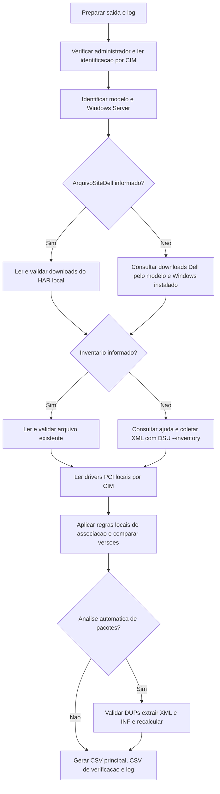

# Relatório local de firmware e drivers Dell PowerEdge

Script PowerShell para apoiar a análise de atualizações em servidores Dell PowerEdge com Windows Server. Compara versões instaladas com uma referência Dell e gera CSV, log e arquivos de diagnóstico. **Não instala atualizações nem reinicia o servidor.**

**Escopo:** BIOS, firmwares e drivers de hardware disponibilizados no suporte Dell. Isso inclui componentes de fabricantes como Broadcom e Intel; o driver não precisa ter autoria da Dell para fazer parte do hardware do PowerEdge. Patches do Windows, atualizações cumulativas e aplicativos ficam com o **Endpoint Central**. O script não consulta Windows Update. O CIM lê dados locais de drivers de dispositivos PCI; somente uma referência Dell validada permite classificá-las como pendentes.

## Resumo: como ele pesquisa em cada servidor

Você executa o mesmo script em cada servidor. **Ele identifica automaticamente a Service Tag, o modelo e o Windows Server instalado**, normalmente sem precisar preencher ou editar essas informações.

1. Identifica a Service Tag, o modelo e o Windows Server da própria máquina.
2. Consulta os downloads Dell pelo **modelo e sistema operacional instalado**, ou lê um HAR salvo manualmente do navegador com `-ArquivoSiteDell`. A Service Tag identifica o servidor no relatório, mas não é enviada na consulta automática padrão.
3. Coleta ou carrega o inventário do DSU e lê os drivers PCI locais pelo CIM.
4. Por padrão, baixa e valida pacotes Dell candidatos, extrai seus metadados e tenta descobrir automaticamente a correspondência entre hardware e versão. Mantém as referências incorporadas quando não há uma substituição automática comprovada.
5. Compara as versões e gera o relatório de pendências identificadas, sinalizando os casos inconclusivos.

O modelo é identificado automaticamente e validado na resposta. Exemplos:

| Servidor identificado | Código consultado |
| --- | --- |
| PowerEdge R530 | `poweredge-r530` |
| PowerEdge R740 | `poweredge-r740` |
| PowerEdge R750 | `poweredge-r750` |

**O padrão voltou a ser modelo + sistema operacional (`-ConsultaSite Modelo`).** Execute o script sem parâmetros para usar esse fluxo. A consulta por tag permanece somente como opção experimental explícita (`-ConsultaSite ServiceTag`); ela não é executada no modo padrão.

**Alternativa manual, sem complemento de navegador:** abra o site Dell pela Service Tag, selecione o Windows correto e exporte um arquivo **HAR sanitizado** pela guia Rede do Edge ou Chrome. O parâmetro `-ArquivoSiteDell` usa esse arquivo no lugar da consulta HTTP do script. Não é necessário copiar cada atualização ou baixar seus pacotes. Consulte o [passo a passo de importação manual](docs/Importacao-Manual-Dell.md).

**Situação da validação: consulta por tag experimental e sem sucesso online confirmado.** O fluxo foi testado com HTTP simulado, mas a tentativa online retornou HTTP 403 neste ambiente e uma execução posterior no servidor também foi recusada. Não há uma correção de acesso validada. O teste anterior bem-sucedido de 352 registros foi por modelo, não por tag. Consulte os detalhes e evidências da seção 3.

Os detalhes técnicos, as regras de comparação e suas limitações estão nas seções seguintes. A [pesquisa de alternativas para consulta por Service Tag](docs/Pesquisa-ServiceTag.md) avalia coleta no navegador, APIs, ferramentas Dell e uma proposta de validação, sem presumir que o bloqueio HTTP tenha sido resolvido.

**Alcance atual:** as referências incorporadas identificam BIOS, iDRAC, firmware PERC e CPLD quando há referência inequívoca, além dos discos e perfis Broadcom documentados adiante. A análise automática pode acrescentar outros drivers PCI e firmwares a partir dos metadados dos próprios pacotes, sem uma regra por modelo de servidor. Componentes sem identidade ou versão comprovadas continuam **inconclusivos**. O relatório não certifica que todo o servidor esteja atualizado.

Este é um script próprio. As fontes de downloads e os comandos do DSU são da Dell; as regras de associação e comparação deste projeto não são uma engine de aplicabilidade fornecida ou certificada pela Dell.

## 1. Executar no servidor

Requisitos: Windows PowerShell **5.1**, sessão de **administrador** e **Dell System Update (DSU)** instalado para uma coleta nova. A lista pode vir da Dell ou do HAR local. A análise automática de pacotes exige acesso HTTPS para downloads; para usar apenas HAR/XML e referências incorporadas, informe `-AnalisePacotes Desativada`. O próprio DSU pode precisar de rede para coletar o inventário. A [documentação Dell do DSU][dsu] descreve a ferramenta e seus requisitos; a compatibilidade do DSU deve ser conferida para o modelo e o Windows Server usados.

Copie apenas `Gerar-RelatorioDell.ps1` para uma pasta local do servidor, abra o Windows PowerShell como administrador, entre nessa pasta e execute:

```powershell
.\Gerar-RelatorioDell.ps1
```

A pasta `Relatorios` será criada automaticamente ao lado do script. Não é necessário copiar `tests` ou `docs` para o servidor para executar o relatório. Preserve a codificação UTF-8 **com BOM** do `.ps1`.

Para escolher uma pasta local ou UNC:

```powershell
.\Gerar-RelatorioDell.ps1 -CaminhoSaida 'C:\RelatoriosDell'

.\Gerar-RelatorioDell.ps1 -CaminhoSaida '\\ARQUIVOS\Relatorios\ClienteA'
```

Para reaproveitar o XML já coletado **neste mesmo servidor**, inclusive junto com os downloads do HAR:

```powershell
.\Gerar-RelatorioDell.ps1 -ArquivoInventario '.\InventarioDell.xml'

.\Gerar-RelatorioDell.ps1 -ArquivoSiteDell '.\DownloadsDell.har' -ArquivoInventario '.\InventarioDell.xml'
```

**Prefira XML:** ele preserva modelos de discos físicos atrás da PERC, baias/FQDD, Component IDs e PCI IDs que podem não aparecer no resumo textual. O parâmetro detecta XML `SVMInventory` com `schemaVersion="1.0"` e continua aceitando o texto antigo. O XML precisa estar completo, com dispositivos e suas aplicações/versões; não exige `Exiting DSU!`. O texto importado continua exigindo essa mensagem e linhas numeradas reconhecidas. Arquivos acima de 10 MiB, XML inválido ou com DTD são recusados.

A importação **não comprova a identidade da máquina nem a atualidade da coleta**: use somente inventário deste servidor. O caminho e a data de modificação são registrados no log. Administrador continua sendo exigido também nesta modalidade.

Sem `-ArquivoInventario`, a coleta prefere automaticamente o XML quando a ajuda do DSU anuncia a opção. Para gerar um XML separadamente, confira primeiro `DSU.exe --help` e execute o comando de inventário:

```powershell
& 'C:\Program Files\Dell\DELL EMC System Update\DSU.exe' --inventory "--output-inventory-xml=$env:TEMP\InventarioDell.xml"
```

A Dell documenta essa exportação no [manual do DSU 1.9.2.0][xml-dsu]. O formato aceito foi conferido também no XML real fornecido em 29/10/2026. Não é necessário atualizar o DSU apenas para tentar essa opção; confira a compatibilidade de qualquer nova versão com o Windows Server e o PowerEdge antes de instalá-la.

### Alternativa manual: downloads salvos do navegador

Exporte o HAR conforme o [guia de captura](docs/Importacao-Manual-Dell.md), copie o arquivo para o servidor e execute:

```powershell
.\Gerar-RelatorioDell.ps1 -ArquivoSiteDell 'C:\Dell\DownloadsDell.har'
```

Para reutilizar também o inventário já concluído deste servidor:

```powershell
.\Gerar-RelatorioDell.ps1 -ArquivoSiteDell 'C:\Dell\DownloadsDell.har' -ArquivoInventario "$env:TEMP\InventarioDell.xml"
```

O script identifica produto e SO da captura, confere sua correspondência com o servidor e lê os metadados dos downloads. O modo padrão continua sendo **Modelo**: usa a lista ampla do modelo, mesmo se a resposta tiver sido obtida por um endpoint de tag. Abrir uma página pela tag não comprova que todos os registros listados sejam aplicáveis ao hardware atual. Na imagem usada como referência, a aba **All PowerEdge R530** indica a lista ampla; o Windows Server 2012 R2 selecionado ali deve ser trocado se o servidor executar Windows Server 2016.

Não entregue print, PDF, HTML salvo ou o resultado de **Download Selected**. O HAR deve conter a resposta de downloads; o script rejeita ausência de corpo, contexto errado, lista vazia, dados inválidos ou respostas ambíguas. A importação não refaz a consulta HTTP da lista; a fase seguinte pode baixar pacotes conforme descrito abaixo. Um HAR inválido não causa uma tentativa automática de consultar outra fonte.

### Análise automática dos pacotes Dell

**Ativa por padrão em `-Fonte Site` (`-AnalisePacotes Automatica`).** Você continua fornecendo o HAR e executando o mesmo script. Ele usa os links e hashes SHA256 dos arquivos presentes nessa resposta para obter metadados que não estão na tabela de downloads. Não é necessário cadastrar uma regra por fabricante para cada pacote cujo formato seja reconhecido.

#### Em linguagem simples: como escolhe e baixa os pacotes

**Inconclusivo é um componente instalado cuja situação ainda não pôde ser confirmada.** Não significa necessariamente que o modelo do servidor não foi encontrado no site Dell.

1. **De onde vêm os candidatos?** Da lista de downloads Dell para o modelo e Windows do servidor. Ela é obtida pela consulta online ou lida do HAR que você entrega. Essa lista já contém nomes, tipos, versões, datas, links dos arquivos e hashes SHA256; o script não inventa endereços de download.
2. **Como escolhe o que investigar?** Separa BIOS, firmwares e drivers com pacote Windows. Prioriza os candidatos que parecem relacionados aos componentes inconclusivos, usando modelo físico, termos do nome e famílias como fonte/PSU, chipset e controladora. Considera correspondência, data e tamanho. Por padrão, examina até **30 pacotes** por execução.
3. **Como baixa?** Faz o download direto por HTTPS dos repositórios oficiais `downloads.dell.com`/`dl.dell.com`, sem abrir o navegador. Se o arquivo já estiver no cache, reutiliza-o. Antes de extrair, confere novamente SHA256 e assinatura digital Dell.
4. **Como confirma que o pacote corresponde ao componente?** Extrai os metadados e cruza os identificadores de hardware e o Windows atendido com o inventário local. Para drivers com INF utilizável, obtém a versão real do driver e a compara com a informada pelo CIM. Para firmware, aplica os critérios de identidade e comparação descritos abaixo.
5. **Qual é o resultado?** Com evidência suficiente, classifica como pendente, atualizado na referência ou acima da referência. Se faltar informação, houver ambiguidade ou a extração falhar, mantém inconclusivo.

**Escolher um candidato para baixar é uma pista para investigação, não uma confirmação de que ele serve.** Baixar e extrair também não garante resolver um inconclusivo. O script não instala as atualizações.

#### O que ele lê depois de descompactar?

O script lê **os metadados que descrevem o pacote**. São as informações que dizem qual atualização está ali, quais dispositivos ela atende e qual versão oferece.

| Arquivo | O que o script procura |
| --- | --- |
| **`package.xml`** | Identificação e versão do pacote, tipo de componente, modelos de servidor e Windows atendidos, ComponentIDs e identificadores PCI dos dispositivos compatíveis. |
| **Arquivos `.inf` de drivers**, quando disponíveis | Hardware atendido, classe do dispositivo, arquitetura/Windows compatível e **versão real do driver**, pelo campo `DriverVer`. Essa versão pode ser diferente da versão da suíte indicada no nome do download. |
| **Alguns XML auxiliares reconhecidos** | Identificação da família do driver e seu nome no inventário. |

Depois cruza esses dados com o **DSU e o CIM**, que informam o hardware e as versões instaladas. A presença de um arquivo XML/INF, sozinha, não confirma a correspondência: os identificadores, o Windows e as versões também precisam atender aos critérios de comparação.

Antes da extração, o pacote passa pela conferência de SHA256 e assinatura digital Dell. A análise não executa os instaladores ou scripts internos do pacote. Quando os metadados ficam dentro de outro instalador, o formato não é reconhecido ou a comparação não pode ser comprovada, mantém o resultado inconclusivo.

Exemplo validado no servidor de teste: o pacote **T244W** expôs XML e INF compatíveis com a identidade PCI da PERC H730P Mini. O CIM informou o driver instalado **6.603.6.0**, e o INF do pacote informou **6.604.06.00**. A análise automática identificou essa pendência sem cadastrar uma regra específica para T244W; o resultado passou de 12 para 13 pendências, mantendo cinco inconclusivos.

Os parâmetros e os detalhes técnicos dessa investigação estão a seguir.

```powershell
.\Gerar-RelatorioDell.ps1 -ArquivoSiteDell '.\DownloadsDell.har' -ArquivoInventario '.\InventarioDell.xml'

# Cache opcional em outra pasta LOCAL; a saída dos relatórios continua aceitando UNC.
.\Gerar-RelatorioDell.ps1 -ArquivoSiteDell '.\DownloadsDell.har' -CaminhoCachePacotes 'C:\DellCache' -LimitePacotes 30

# Sem download/extração de pacotes: utiliza somente referências incorporadas.
.\Gerar-RelatorioDell.ps1 -ArquivoSiteDell '.\DownloadsDell.har' -ArquivoInventario '.\InventarioDell.xml' -AnalisePacotes Desativada
```

O cache padrão é **`%ProgramData%\RelatorioDell\CachePacotes`**, criado automaticamente. O primeiro uso pode demorar e ocupar espaço. O cache guarda os executáveis por SHA256. Em cada análise eles são validados e extraídos novamente: o script não confia em metadados antigos editáveis. O cache não pode ser UNC, reparse point ou caminho com mais de 100 caracteres, para compatibilidade com PowerShell 5.1. Pode ser removido manualmente quando não estiver em uso; será reconstruído.

#### Como o script obtém e usa os metadados

1. **Seleciona candidatos:** mantém BIOS, firmware e drivers com DUP Windows. Usa a primeira comparação para investigar antes os componentes **inconclusivos**, por modelo físico ou termos/famílias do componente. Reconhece vocabulário como `Power Supply`/`PSU`/fonte, chipset, SEP/backplane, CPLD, BIOS, iDRAC, controladoras, rede e discos. Não contém uma lista de fabricantes ou pacotes favorecidos. Ignora termos genéricos como `firmware`, e muitas portas iguais não aumentam artificialmente o peso. Dentro da prioridade, considera correspondência, data mais recente e tamanho. Essa ordem só prioriza a investigação; nomes parecidos não autorizam uma pendência.
2. **Confere a origem:** aceita somente HTTPS de `downloads.dell.com`/`dl.dell.com`, porta padrão e nome exato do arquivo, sem credenciais, query ou fragmento. O alias `dl` é normalizado para `downloads`; redirecionamentos não são seguidos. O HAR passa a preservar URL validada, SHA256 e tamanho, sem copiar cookies ou a navegação completa.
3. **Valida o arquivo:** exige SHA256 igual à referência e Authenticode `Valid`, com identidade Dell Inc./Dell Technologies Inc. Não desabilita certificados. Link, hash ou assinatura ausentes/inválidos impedem a extração. O cache também é revalidado; um binário adulterado é descartado para novo download.
4. **Extrai sem instalar:** prefere o 7-Zip já instalado em `Program Files`, sem baixá-lo. Usa a linha básica `x -y -o"<pasta>" "<pacote>"`, sem opções `-bs*` de controle de saída; stdout/stderr já são capturados em arquivo. Isso reduz dependências de sintaxe entre versões e preserva as mensagens reais do extrator. Se ele não expuser o manifesto, ou estiver ausente, usa **somente** a extração documentada do DUP: `/s /e="<pasta>" /l="<log>"`. As opções ficam sem aspas; os valores dos caminhos são citados. Cada extrator recebe uma pasta vazia exclusiva, e o log fica **fora** dela. A Dell informa que não extrai para uma pasta com conteúdo. A leitura usa somente a tentativa que teve sucesso, sem misturar resíduos do 7-Zip. Essa alternativa inicia o executável Dell validado em modo de extração e exige administrador. Nunca usa `/s` isolado, `/f`, `/r` ou instaladores internos. Consulte as [opções Windows do DUP][dup-cli].
5. **Lê `package.xml`:** exige `SoftwareComponent`, schema `1.0`, identidade/releaseID, tipo, formato e versão coerentes com a referência. Lê ComponentIDs, tuplas PCI, sistemas e SOs atendidos. XML com DTD, schema desconhecido ou manifesto ambíguo é recusado.
6. **Descobre a versão do driver:** quando há INF exposto, lê `DriverVer`, `Class`, `Manufacturer` e `Models`. Escolhe arquitetura amd64 e decoração compatível com versão/build e ProductType do Windows. Cruza os IDs do INF com os do manifesto; não usa IDs de seções arbitrárias. Compara o `DriverVer` com o CIM, **não a versão da suíte**. Referências Microsoft: [DriverVer][inf-driverver], [Manufacturer/TargetOSVersion][inf-manufacturer] e [Models][inf-models].
7. **Compara e registra:** as referências derivadas alimentam a engine por dispositivo. Exige identidade, versão válida, assinatura indicada pelo CIM e cobertura das instâncias; versões distintas geram grupos separados. Provedor Microsoft não bloqueia sozinho a análise. Firmware pode receber comparação numérica automática quando o pacote tem um único ComponentID, hardware/modelo e SO comprovados. Uma referência mais nova interpretada não mantém o firmware confirmado apenas pela referência antiga.

A lógica continua independente do modelo de PowerEdge. Os metadados incorporados, como 49X84, permanecem como referências já verificadas quando a extração não expõe uma versão equivalente. Um INF do próprio pacote pode substituí-los naquela versão. `drivers-referencias.json` registra os dados efetivamente usados.

#### Limites e significado de inconclusivo

| Condição | Comportamento |
| --- | --- |
| Não é DUP x64 (`LW64`), URL/hash ausentes ou assinatura não confirmada | Não executa o pacote; registra o motivo. |
| INF dentro de instalador/MSI/CAB/ZIP interno ou formato desconhecido | Não executa o payload nem adivinha a versão. Esta versão lê INFs expostos pela extração do DUP; não extrai recursivamente instaladores internos. |
| Revisão de silício obrigatória, SuiteMask ou override `DriverVer` em DDInstall decorado | Não amplia suporte por suposição. Overrides DDInstall simples são respeitados; casos não resolvidos ficam sem referência automática. |
| Firmware alfanumérico ou pacote com múltiplos ComponentIDs | Pode identificar o pacote, mas não faz comparação numérica automática. As regras específicas anteriores mantêm sua cobertura documentada. |
| SO/edição não comprovados, hardware divergente ou referência ambígua | Mantém inconclusivo. Para BIOS, ComponentID igual sozinho não basta: exige modelo atendido. |
| Compatibilidade global de instalação | Não reproduz o ranking completo do Windows nem valida estado do RAID, pré-requisitos e combinação firmware/driver. O modo `/c` do DUP existe, mas **não é executado por esta funcionalidade** nem usado como prova isolada de versão pendente. |

Limites: **30 pacotes por execução**, ajustáveis com `-LimitePacotes`; reserva conservadora de **2 GiB** de arquivos examinados (também pode contar o cache); **512 MiB por download**, até **120 segundos** de transferência; até **3 minutos** para extrair cada pacote. Há avisos periódicos de progresso. Três falhas consecutivas de rede interrompem novas tentativas. A árvore extraída é conferida contra reparse points, 10000 entradas e 2 GiB **após** a extração; isso não é uma quota do sistema de arquivos.

Limites, bloqueios HTTP e extrações parciais **não significam “sem atualizações”**. Cada candidato aparece em `pacotes-analise.csv`. Se a etapa ficar parcial e não houver outro inconclusivo, o relatório acrescenta um aviso de análise incompleta, impedindo “Nenhuma atualização pendente”. Esse aviso é da coleta, não um componente físico novo. Não há garantia de eliminar todos os inconclusivos.

#### Arquivos para auditoria

- `pacotes-analise.csv`: DriverId, arquivo, SHA256, origem cache/download, thumbprint do assinante, situação e motivo. Inclui `Etapa`, `Diagnostico`, `Prioridade`, `MotivoPrioridade`, `BytesBaixados` e `AvisoLimpeza`. A explicação de limite distingue quantidade, reserva de bytes e interrupção por rede.
- `pacotes-metadados.json`: ComponentIDs/PCI, versão do pacote, compatibilidade observada e referências dos INFs, com hashes do manifesto e dos INFs.
- `drivers-referencias.json`: referências incorporadas/automáticas efetivamente usadas.
- `_Verificacao.csv`: identidade, origem da versão e motivo de cada resultado; `TipoDSU` preserva o tipo original.
- `pacotes\<DriverId>_<SHA256 inicial>\`: preserva `7zip.processo.json`/`dup.processo.json`, os respectivos `.stdout.txt`/`.stderr.txt` e `dup.log`, conforme os extratores iniciados. O JSON registra executável, versão do 7-Zip quando disponível (`VersaoExtrator`), argumentos exatos, diretório, PID, início/fim, código decimal/hexadecimal, erro e conclusão da captura. Se o DUP não criar seu log, os registros do processo continuam disponíveis. A saída extensa de ajuda fica no arquivo, sem inundar o console.

O contador soma **bytes de conteúdo recebidos**, incluindo downloads parciais e arquivos cuja validação ou extração posterior falhou. Pacotes reutilizados do cache contam zero bytes de download. Ele não mede cabeçalhos ou todo o tráfego da conexão.

As extrações exclusivas são limpas após a leitura, com conferência do caminho. Seus logs ficam em uma pasta local separada no cache (`extracao_<id>.logs`), preservada também em caso de falha, e são copiados para o diagnóstico da execução. Assim, o DUP pode registrar localmente mesmo quando a saída dos relatórios é UNC. Apenas nomes conhecidos e arquivos de até 20 MiB são copiados; se a cópia falhar ou ultrapassar esse limite, a auditoria informa o caminho local preservado. A limpeza do payload não apaga esses logs. Estruturas recusadas ou arquivos presos podem permanecer para inspeção. Não publique o cache no Git. O inventário e os dados CIM permanecem locais; a Dell recebe solicitações dos arquivos públicos e os dados normais da conexão.

**Falha de limpeza não invalida a análise.** Se a remoção temporária falhar, o script mantém os metadados válidos e registra um aviso no log, em `AvisoLimpeza` no CSV de pacotes e em `limpeza.json` na pasta de logs do cache e no diagnóstico da execução, quando graváveis. Se a análise já tinha falhado, o erro original permanece em `Detalhe`; o erro secundário fica separado. O JSON registra ambos os erros e o caminho que permaneceu para inspeção. O script não amplia o alvo da remoção nem tenta apagar outras pastas para contornar a falha. Um aviso de limpeza, sozinho, não transforma metadados válidos em análise inconclusiva.

## 2. Como funciona a engine

O padrão é `-Fonte Site`. As etapas acontecem **em sequência**, na própria máquina:



### Identificação e coleta

| Informação | Fonte usada pelo código |
| --- | --- |
| Hostname | `Environment.MachineName` |
| Service Tag | `Win32_BIOS.SerialNumber`, por CIM local |
| Modelo | `Win32_ComputerSystem.Model`, por CIM local |
| Windows Server instalado | `Win32_OperatingSystem.Caption` e `ProductType` |
| Componentes e versões instaladas | XML de `DSU.exe --inventory --output-inventory-xml=...`, se anunciado na ajuda; texto em versões sem essa opção; ou arquivo importado |
| Modelo físico, baia e identificadores de hardware | Atributos de `Device` no XML DSU, associados a cada `Application`; ausentes quando não fornecidos pelo coletor/texto |
| Versão efetiva dos drivers PCI | CIM local `Win32_PnPSignedDriver`; a associação exige metadados Dell, sem consulta a patches do Windows |
| Versões publicadas, criticidade, data e pacote | Interface interna de Drivers & Downloads no site Dell, consultada por HTTP ou lida da resposta salva no HAR |

**A consulta padrão ao site usa modelo + sistema operacional**, identificados localmente. O script chama `packdriversbyproduct` e compara os downloads recebidos com o inventário atual. A Service Tag, lida de `Win32_BIOS.SerialNumber`, é incluída no relatório e no log, mas não é enviada nessa consulta.

Com `-ArquivoSiteDell`, a consulta HTTP é substituída pela leitura local da resposta do HAR. O importador valida a origem Dell, o produto e o SO solicitados, o status HTTP e o conteúdo da resposta; aceita texto, base64 e a transformação de resposta já usada pelo site. A seleção de escopo continua sendo definida por `-ConsultaSite`. `Modelo` não exige tag nem aplica o filtro de tag, e esse escopo fica registrado nos metadados da fonte.

Ao informar `-ConsultaSite ServiceTag` **sem HAR**, o script tenta abrir o endereço Dell da tag e extrair o identificador fornecido na URL canônica ou no contexto da página. O JavaScript Dell chama esse valor de `encryptedServiceTag`; o script não tenta gerá-lo nem descriptografá-lo. Em seguida, envia esse identificador a `packdriversbytag`, mantendo modelo e SO como parâmetros de contexto. Esse fluxo automático é experimental e tem bloqueio HTTP 403 observado.

O código do SO é derivado do Windows do servidor, e não do filtro escolhido em um navegador de outra máquina. Exemplos do mapeamento implementado: 2012 R2 → `W12R2`, 2016 → `WST14`, 2019 → `WS19L`, 2022 → `WS22L` e 2025 → `WS25L`.

No modo automático experimental por tag, o fluxo exige confirmação `IsTag = true`, identidade correspondente à tag/identificador consultado, ausência do sinal de falta de dados por tag e marcações válidas `IsTagDriver`. **Nesse modo, só registros com `IsTagDriver > 0` entram na comparação.** A lista ampla pode vir na mesma resposta, mas não é usada como substituição silenciosa. Uma consulta por tag também não comprova que os componentes originais continuem instalados; o inventário atual permanece necessário.

Na importação manual com `-ConsultaSite ServiceTag`, a identidade exigida é a **Service Tag em texto claro na resposta, igual à lida do BIOS**. Apenas um identificador opaco na URL ou na resposta não comprova essa correspondência. Se a captura não trouxer essa identidade ou os dados marcados para tag, a importação estrita falha; é possível escolher explicitamente `-ConsultaSite Modelo` para usar a referência ampla, sem alegar validação por tag.

Sem arquivo importado, o script localiza o DSU, executa `--help` e confere `--inventory`. Se a ajuda anunciar `--output-inventory-xml`, executa **as duas opções juntas** e lê o XML após o término com código zero. Se a ajuda não anunciar exportação XML, registra um aviso e usa o texto, com menor identificação de hardware. Quando o XML foi solicitado, ausência, truncamento ou erro da coleta interrompem o relatório: não há fallback textual para esconder a falha. Não usa `--preview` no modo Site. O DSU mantém suas próprias comunicações e pode baixar o coletor de inventário. Consulte o [inventário][inventario-dsu] e a [exportação XML][xml-dsu] documentados pela Dell.

No XML, `Application.display`, `version` e `componentType` informam nome, versão e tipo. `Device.display` pode conter o modelo físico que faltava no texto. São preservados `componentID`, `FQDD`, os quatro PCI IDs, endereço bus/device/function e `enum`, quando presentes. Discos e interfaces iguais continuam sendo instâncias separadas. IDs coletados não são, por si só, prova de correspondência com um pacote do site.

### Associação dos componentes

O tipo informado pelo DSU separa `BIOS`, `FRMW` e `DRVR`. Aplicativos `APAC`, `APP` e `EAPP` são excluídos. Registros sem tipo reconhecido são preservados como inconclusivos.

| Grupo | Regra implementada no modo Site |
| --- | --- |
| BIOS | Procura registros `Type = BIOS` na lista selecionada pela consulta. No modo experimental ServiceTag, essa lista já foi filtrada por `IsTagDriver > 0`. |
| iDRAC | Reconhece o nome do controlador no inventário e procura firmware cujo título comece com `iDRAC`. |
| PERC | Extrai o modelo de um nome que comece com `PERC` ou `Dell PERC` e exige esse modelo como um token completo no título do firmware. `H730` não equivale a `H730P`. |
| CPLD | Para `System CPLD`, procura firmware com `CPLD` no título. |
| Discos com regra XML | Exige firmware, FQDD de disco em baia, modelo e ComponentID específicos. Confere também DriverId e modelo no título do pacote. Aceita somente os pares de versões explicitados abaixo. |
| Firmware Broadcom BCM5720 | Compara FFV com DFF48 somente nos dois perfis PCI completos documentados abaixo. A versão do bootcode não é usada como FFV. |
| Drivers PCI | Engine comum guiada por metadados de pacote, hardware, SO e espaço de versão. A base incorporada é 49X84/NDIS, com 33 perfis PCI e Windows Server 2016/2019; XML/INF interpretáveis podem acrescentar referências automaticamente. Classes aceitas: NET, SCSIAdapter, HDC, System, Display, Media e USB, somente com dispositivo PCI comprovado. |
| Demais firmwares | A fase automática tenta associar ComponentID/PCI, modelo, SO e versão do manifesto. Comparação numérica exige pacote de um único ComponentID; os limites estão na seção de análise automática. Sem evidência suficiente, mantém inconclusivo. |

BIOS/iDRAC/PERC/CPLD usam **tipo e textos de identificação/família**; discos usam também ComponentID e FQDD; Broadcom usa os quatro PCI IDs do XML. O script não executa a verificação de compatibilidade do DUP e não comprova todas as pré-condições de instalação. Uma pendência identificada aqui deve ser validada na página do pacote antes de uma eventual atualização. A Dell distingue descoberta automática e downloads manuais em seu [guia de atualização PowerEdge][metodos-dell].

#### Drivers PCI: associação por metadados, independente do modelo

A engine de drivers separa **dados do pacote** de **lógica de comparação**. `Get-DellDriverDefinitions` contém os dados de referência incorporados ao `.ps1`; não é preciso copiar um arquivo auxiliar para o servidor. Cada entrada informa ComponentID/nome do inventário, famílias e tuplas PCI completas, Windows atendido, DriverId, arquivo/tipo do DUP e a versão efetiva do driver, distinguindo-a da versão de família/suíte.

O fluxo é:

1. Coleta os drivers de dispositivos PCI pelo CIM, independentemente do fabricante ou provedor instalado. As referências incorporadas iniciais são de rede; os INFs automáticos podem acrescentar outras classes PCI reconhecidas.
2. Seleciona somente pacotes presentes na referência Dell consultada/importada, conferindo DriverId, versão de família, nome/tipo do arquivo, SO e data. Referências conflitantes na mesma data ficam inconclusivas.
3. Confere VendorID, DeviceID, SubVendorID e SubDeviceID. O ID da instância PNP deve ser coerente com esses quatro campos, conforme os [identificadores PCI documentados pela Microsoft][pci-identificadores].
4. Exige versão comparável, assinatura informada pelo CIM e IDs de instância únicos. Quando o XML lista as interfaces, exige cobertura por perfil e quantidade; não há quantidade fixa de placas ou portas.
5. Compara cada grupo de versão instalada separadamente. Um servidor com versões distintas pode ter uma linha pendente e outra atualizada para a mesma família, com quantidade, provedor, INF e instâncias rastreáveis no CSV de verificação.

**O provedor instalado é informativo.** Um driver assinado com provedor `Microsoft` pode ser comparado com um pacote Dell se o hardware, SO e versões estiverem associados. Não há exceção para `17.2.1.0`, `netb57va.inf`, hostname, Service Tag ou R530 na engine. Se o DSU não trouxer um registro DRVR de família, o CIM pode complementar o inventário quando houver hardware reconhecido e pacote Dell correspondente na referência. Isso não adiciona patches do Windows ao escopo.

**A base incorporada não é universal:** começa com o pacote 49X84 e é complementada pela análise automática de XML/INF descrita acima. O driver cobre **33 perfis PCI**, derivados da interseção entre `SupportedDevices/PCIInfo` do `package.xml` e as famílias `14E4:1657`/`14E4:165F` declaradas no `nxUDUPconfig.xml`. A lista ampla do DUP contém outros dispositivos; eles não foram incluídos apenas por aparecerem nela. A [evidência da generalização](docs/evidencias/drivers-genericos-2026-10-29.json) registra essa seleção e as fontes.

Para pacotes com XML/INF reconhecidos, essa entrada é derivada automaticamente, com a proveniência registrada no diagnóstico. Quando o formato não é reconhecido, ampliar o leitor ou incorporar uma referência exige validar hardware, SO e versão efetiva, registrar a fonte e acrescentar regressões. A lógica não deve ganhar condições por modelo de servidor ou provedor. Um pacote sem essa evidência continua inconclusivo. As regras anteriores de firmware e discos mantêm sua cobertura documentada.

#### Broadcom: referências de firmware e driver da amostra

Foram baixados os pacotes oficiais [DFF48][broadcom-fw] e [49X84][broadcom-driver] e extraídos estaticamente com 7-Zip, sem executar os instaladores, scripts ou payloads. Os SHA256 coincidiram com os publicados pela Dell e a verificação Authenticode local retornou `Valid`, assinante Dell Inc. A proveniência, hashes e limites estão em [evidência Broadcom de 29/10/2026](docs/evidencias/broadcom-2026-10-29.json). **7-Zip é opcional no servidor**: a nova fase automática prefere a instalação existente, mas pode usar a extração nativa do DUP. As referências incorporadas continuam disponíveis.

Os `package.xml` de ambos os DUPs incluem os perfis abaixo; a coluna `family` do `bcmnxfw.cfg` confirma a FFV `22.00.6` para ambos:

| VendorID | DeviceID | SubVendorID | SubDeviceID | Uso na amostra |
| --- | --- | --- | --- | --- |
| `14E4` | `165F` | `14E4` | `2003` | Duas interfaces |
| `14E4` | `165F` | `1028` | `0639` | Quatro interfaces |

Firmware usa somente o pacote DFF48 presente na referência selecionada, versão FFV `22.00.6`, comparada numericamente com a FFV do DSU, como `20.06.18`. A [referência antiga 1T8HX][broadcom-fw-antigo] também publica `20.6.18`, sustentando a identificação dessa família de versões. Versão interna como bootcode `1.39`, outro perfil PCI ou um novo alvo de pacote ficam inconclusivos até validação da regra.

**Limite importante no Windows Server 2016:** a página e as notas do DFF48 listam Windows 2019/2022, sem 2016. O R530 e os dispositivos aparecem como atendidos, e a captura WST14 contém o pacote, mas isso não confirma a execução do instalador no Windows 2016. O relatório registra a diferença de firmware e acrescenta essa ressalva no `Motivo`. Antes de instalar, valide com a Dell o método fora do SO e os pré-requisitos. As instruções Dell oferecem atualização pelo Lifecycle Controller; nenhum desses métodos é executado pelo script.

Para o **driver**, o coletor `nxUDUPconfig.xml` do 49X84 usa o ComponentID `8641`, consulta `HKLM\SOFTWARE\Dell\MUP\Broadcom\UInstaller\Product_Version` e tem `0.0.0` como valor padrão sem versão. Isso explica como um zero pode aparecer, mas não comprova qual condição ocorreu no Registro do servidor. O script não executa esse VBS nem depende dessa chave para decidir o estado do driver.

A consulta [Win32_PnPSignedDriver][cim-driver] obtém versão, provedor, assinatura, INF e PCI IDs. As validações são as da engine genérica acima; versões distintas geram grupos separados e provedor Microsoft não é rejeitado por nome. Dados ausentes, divergentes ou sem assinatura preservam o inconclusivo. Usa **timeout de operação de 60 segundos por tentativa**. Se falhar, registra o motivo, espera dois segundos e faz **uma única nova tentativa**; sucesso na primeira não repete a consulta. Dados parciais de uma tentativa interrompida não se misturam com os da seguinte. Após duas falhas, registra a falha da coleta e conserva como inconclusivos os casos sem evidência; não trata a falha como driver atualizado. Não reinicia serviços nem usa uma fonte diferente como substituição silenciosa. A indicação de assinatura vem do CIM e não substitui uma verificação própria dos arquivos instalados.

As [notas oficiais do 49X84][broadcom-driver-notas] distinguem a família `21.80.3` do driver **NDIS `214.0.0.6`**. `VersaoAtual`/`VersaoNova` usam NDIS nessa linha; a versão zero original permanece em `VersaoDSU`. O nome do pacote continua contendo sua versão de família. O mapeamento validado é restrito a Windows Server 2016/2019. A coleta real recebida confirmou seis drivers `17.2.1.0`, provedor Microsoft, assinados segundo o CIM; o reprocessamento com a nova engine está registrado abaixo.

Firmware e driver são comparados separadamente. Isso **não certifica que DFF48 e 49X84 formem uma combinação recomendada**: as notas Dell condicionam o uso a versões compatíveis. A instalação exige conferir a combinação no procedimento de manutenção.

O `Chipset INF` continua sendo um driver de hardware em escopo, mesmo com atualização do Windows delegada ao Endpoint Central. A [página Dell 99GP4][chipset-inf] informa que esse pacote aplica identificação aos dispositivos e pode não alterar a versão quando essa identificação já existe. Portanto, versão zero não é convertida automaticamente em pendência do chipset nem comparada com a versão de um driver genérico do Windows.

#### Discos: regras restritas, sem ordenação alfabética

| Identidade exigida no XML | Pacote presente na referência consultada | Pares aceitos pela regra local |
| --- | --- | --- |
| `MG04SCA20ENY`, ComponentID `105266`, FQDD `Disk.Bay...` | [Toshiba RG9MK / EG03][toshiba-eg03], título contendo o modelo | `EG02 → EG03`: pendente; `EG03 = EG03`: atualizado na referência |
| `ST8000NM023B-2TJ` ou `ST8000NM023B-2TJ133`, ComponentID `111175`, FQDD `Disk.Bay...` | [Seagate P183W / LA0C][seagate-la0c], título contendo `ST8000NM023B` | `LA0B → LA0C`: pendente; `LA0C = LA0C`: atualizado na referência |

A página Dell RG9MK identifica os modelos Toshiba e a versão EG03; a P183W identifica o modelo completo Seagate `ST8000NM023B-2TJ133` e a versão LA0C. O XML observado abrevia esse modelo para `ST8000NM023B-2TJ`; a regra aceita **essa abreviação exata junto com o ComponentID observado**, sem aceitar qualquer sufixo. Ambos os pacotes estão na captura R530/Windows Server 2016 analisada e têm DUP Windows.

Essas regras são uma **inferência local documentada** entre a identidade/versão observada e a referência publicada, não uma autorização de atualização ou uma matriz de transições certificada pela Dell. As páginas não comprovam todas as condições do servidor, RAID ou disco. ComponentIDs vieram do XML observado, não de um contrato da API. Outro modelo, CID, pacote ou par de versões fica inconclusivo. Por exemplo, `EG04` instalado ou publicado não é ordenado contra `EG03`; exige ampliar a regra com evidência e teste. A referência continua vindo do HAR/site: pacote ausente na consulta não gera pendência.

### Escolha da referência e comparação

Para cada componente com regra de associação, o código:

1. Mantém candidatos com pacote Windows `.EXE` classificado como `LW64` ou `LWXP`; prefere `LW64` ao selecionar o arquivo de um registro.
2. Seleciona a **data de lançamento mais recente**, usando `ReleaseDate`. Não escolhe simplesmente o maior número de versão de toda a lista.
3. Se houver versões diferentes empatadas na data mais recente, ou se nenhuma data válida puder ser selecionada, registra inconclusivo.
4. Usa a parte de `DellVer` **antes da primeira vírgula** como versão de referência.
5. Compara os segmentos numéricos. Por exemplo, `2.19.0` é superior a `2.5.4`; `2.19.0.0` equivale a `2.19.0`.
6. Registra versões zero ou não comparáveis como inconclusivas. Firmware alfanumérico só é comparado nos pares explícitos das regras de disco acima. Não sugere downgrade quando a comparação numérica indica instalada superior.

A criticidade vem do texto **`Imp`** e é normalizada para `Urgente`, `Recomendado` ou `Opcional`. Não depende do código numérico `ImpId`. O SO participa do filtro enviado à API; o código atual não revalida localmente a lista `AppOses` de cada pacote.

O texto genérico de uma NIC ou disco não basta para associar seu firmware a um pacote. Além disso, a versão do pacote pode não representar a versão interna de cada dispositivo que ele atende. Por isso esses casos não são convertidos automaticamente em pendência nem em componente atualizado.

## 3. A API: origem, acesso, custo e segurança

### Origem comprovada

É uma **interface interna do site oficial Drivers & Downloads**, no domínio `www.dell.com`. O HTML da página publica a variável `driversByProductDataUrl`; o JavaScript oficial monta a consulta e lê a resposta. Não é uma API de terceiros e não foi encontrada documentação pública específica que ofereça esse endpoint como uma integração suportada, com versão de contrato, preço, limites ou SLA.

A origem foi verificada por três evidências primárias em **28/10/2026**:

| Evidência | Observação |
| --- | --- |
| HTML oficial de `driverhome/defaultview` | Obtido por `POST` com contexto do produto/SO; publicou as URLs `packdriversbyproduct`, `packdriversbytag` e `decryptShift = 3`. |
| [JavaScript oficial da lista][js-lista] | Monta chamadas por modelo ou por `encryptedServiceTag`, chama `ajaxGet`, decodifica a resposta e usa `IsTagDriver > 0` para separar registros da tag. |
| [Carregador oficial da página][js-loader] | Define os headers usados pela página e a transformação da resposta. |

O [registro da consulta anterior por modelo](docs/evidencias/api-dell-2026-10-28.json) contém data/hora, URLs, status HTTP, campos observados e SHA256 dos dois arquivos JavaScript consultados. A [evidência do ajuste por Service Tag](docs/evidencias/api-dell-service-tag-2026-10-28.json) registra o contrato observado no JavaScript, o bloqueio HTTP 403 da tentativa online e os limites dos testes offline. Esses hashes identificam os arquivos examinados; não são assinatura digital nem endosso da Dell ao projeto. Os JavaScripts versionados podem ser substituídos ou removidos pela Dell.

O endereço HTML citado é um endpoint contextual da página, não uma URL de documentação para abrir por `GET`: pode responder 405 nesse uso. O método e o corpo JSON utilizados na verificação anterior estão em `HTMLProvenance` no registro de evidências. Esse `POST` serviu para auditar a origem; o fluxo novo faz `GET` da página pública por tag e depois `GET` do endpoint de downloads, mantendo a sessão HTTP entre as duas chamadas.

### Chamada utilizada

O modo padrão (`-ConsultaSite Modelo`) consulta diretamente os downloads pelo modelo e SO, identificados automaticamente:

```text
GET https://www.dell.com/support/driver/pt-br/dep/api/driverlist/packdriversbyproduct?productcode={MODELO}&oscode={SO}&lob=PowerEdge&initialload=true
```

Somente a opção experimental `-ConsultaSite ServiceTag` segue esta sequência:

```text
GET https://www.dell.com/support/product-details/pt-br/servicetag/{SERVICE_TAG}/drivers
GET https://www.dell.com/support/driver/pt-br/dep/api/driverlist/packdriversbytag?productcode={MODELO}&servicetag={IDENTIFICADOR_FORNECIDO_PELA_DELL}&oscode={SO}&lob=PowerEdge&initialload=true
```

Não há Service Tag fixa no código. A segunda chamada usa o identificador fornecido pela página, codificado para a URL. O script aceita sua obtenção pela URL canônica HTTPS da Dell ou por um valor inequívoco no contexto da página; se isso não puder ser confirmado, interrompe a consulta.

A API por tag pode devolver registros de todo o modelo com `IsTagDriver = 0`. O filtro positivo é aplicado localmente conforme o JavaScript da Dell. O script não copia a alternância automática da interface Dell para a lista do modelo quando há poucos registros da tag.

**Limite de validação online:** a tentativa de carregar a página de uma tag real recebeu HTTP 403 em 28/10/2026. Não foi obtida uma resposta online válida por tag para comprovar seus campos reais e sua contagem; os testes desse fluxo usam respostas sintéticas baseadas no JavaScript. O acesso bem-sucedido anterior foi a consulta por modelo abaixo.

Exemplo real anteriormente testado para R530/Windows Server 2012 R2, correspondente ao modo padrão atual por modelo:

```text
GET https://www.dell.com/support/driver/pt-br/dep/api/driverlist/packdriversbyproduct?productcode=poweredge-r530&oscode=W12R2&lob=PowerEdge&initialload=true
```

| Parâmetro | Valor no teste | Finalidade |
| --- | --- | --- |
| `productcode` | `poweredge-r530` | Modelo de servidor, também enviado como contexto no fluxo por tag |
| `oscode` | `W12R2` | Filtro do sistema operacional |
| `lob` | `PowerEdge` | Família de produtos |
| `initialload` | `true` | Parâmetro observado na chamada da página |

Headers reproduzidos da página: `X-Requested-With: XMLHttpRequest` e `X-Robots-Tag: noindex`. Eles não são credenciais nem prova de autorização contratual.

O teste **por modelo** retornou HTTP 200 e 352 registros, sem login, chave de API ou header `Authorization`. São downloads publicados, não 352 pendências do equipamento nem a contagem confirmada para uma Service Tag. Os registros trazem, entre outros, `DriverId`, `DriverName`, `Type`, `Imp`, `ReleaseDate`, `DellVer`, `CatName`, `FileFrmtInfo` e `OthFileFrmts`.

A resposta observada veio como `text/plain; charset=utf-8`, com uma rotação de letras ASCII descrita pelo próprio loader da Dell. Isso é uma transformação de apresentação, não uma garantia de criptografia, autenticação ou assinatura dos dados. O script aceita JSON aberto ou essa família de rotações e valida o schema e o `ProductCode` antes de usar os registros. Não executa o JavaScript remoto.

### É gratuita?

**A consulta por modelo testada funcionou sem conta, chave ou contratação de plano pago.** O acesso online por tag ainda não foi concluído com sucesso neste ambiente. Não foi identificado preço publicado para esses endpoints internos. Isso não comprova uma licença de integração gratuita ou uma garantia de gratuidade permanente.

A Dell declara que os downloads de drivers e firmware de servidores são gratuitos no site de suporte. Essa afirmação, disponível no [guia oficial][metodos-dell], trata dos **downloads**, não estabelece condições comerciais específicas para automatizar esta interface.

Os [termos de uso do site no Brasil][termos-site-br] apresentam uma permissão genérica de reprodução/distribuição de conteúdo limitada a uso pessoal e não comercial, além de ausência de garantias. Essa permissão não comprova autorização para a automação profissional deste endpoint. A Dell também publica [termos gerais de APIs][termos-api], que tratam de mudanças/descontinuação, limites e disponibilidade. Não foi confirmada uma autorização contratual específica desse endpoint para integração comercial, nem que esses termos gerais constituam seu contrato específico. Portanto, este README não presume autorização irrestrita, suporte oficial ou SLA para a automação.

### O que é verificável sobre segurança?

| Aspecto | Comportamento do script e limite |
| --- | --- |
| Conexão | Usa URL HTTPS da Dell, adiciona TLS 1.2 aos protocolos existentes e não desabilita a validação de certificados do Windows/.NET. `Invoke-WebRequest` pode seguir redirecionamentos. |
| Conteúdo remoto | Processa metadados. O modo Site padrão baixa DUPs candidatos, valida hash/assinatura e extrai. Pode iniciar o DUP apenas com `/s /e`, sem instalar. Não executa JavaScript da página ou instaladores do payload. `-AnalisePacotes Desativada` desliga essa fase. |
| Dados enviados no modo Site | No padrão `Modelo`, são enviados modelo e SO; a tag não participa da requisição. Somente no modo experimental `ServiceTag`, a tag é enviada à página Dell e seu identificador é enviado à API, junto com modelo/SO. Não são enviados hostname ou inventário. A sessão HTTP pode receber cookies do site; não há login nem credenciais adicionadas pelo script. O serviço recebe também IP e headers. |
| DSU local | Executa o binário encontrado ou informado pelo operador. O script não verifica sua assinatura Authenticode/hash e não audita as comunicações internas do DSU. |
| Dados armazenados | CSV, log e diagnóstico podem conter hostname, Service Tag, seu identificador, URL de consulta, componentes e versões. A proteção depende das permissões da pasta/UNC; o script não cria ACLs. Os valores reais da tag/identificador não integram os fixtures nem as evidências versionáveis. |
| Confiança no resultado | Origem HTTPS e schema válido não comprovam completude, aplicabilidade de cada pacote ou ausência de falhas da fonte. Não há verificação própria de assinatura dos metadados da API. |

A [declaração de privacidade da Dell para a América Latina][privacidade] descreve a coleta de IP, URLs, horários e outras informações técnicas em seus serviços. A tag só é transmitida pelo script ao escolher o modo experimental `ServiceTag`; o inventário permanece local. Isso não deve ser interpretado como ausência de registros de acesso pela Dell.

## 4. Saídas e interpretação

Cada execução usa hostname, data, hora e sufixo para evitar sobrescrever relatórios anteriores:

```text
Relatorios/
  DSU_SRV-EXEMPLO_2026-10-28_143025_a1b2c3.csv
  DSU_SRV-EXEMPLO_2026-10-28_143025_a1b2c3_Verificacao.csv
  DSU_SRV-EXEMPLO_2026-10-28_143025_a1b2c3.log
  DSU_SRV-EXEMPLO_2026-10-28_143025_a1b2c3_diagnostico/
```

Os CSVs usam **UTF-8 com BOM**, separador **ponto e vírgula** e não incluem a linha `sep=;`.

O **CSV principal** tem dez colunas:

```text
Hostname;ServiceTag;Modelo;Componente;Categoria;VersaoAtual;VersaoNova;Criticidade;DataDeLancamento;NomeDoPacote
```

Contém as pendências identificadas, ordenadas por **Urgente → Recomendado → Opcional**. Se houver componentes inconclusivos, acrescenta uma linha de aviso de **verificação parcial**, inclusive quando nenhuma pendência tiver sido identificada.

O **`_Verificacao.csv`**, gerado no modo Site, mantém a ordem do inventário e acrescenta `Status`, `Motivo`, `URL`, `FonteVersao`, `VersaoDSU`, `InfName`, `QuantidadeDispositivosDriver`, `ProvedorDriver`, `PnpDeviceIDs`, `TipoDSU`, `ModeloDispositivo`, `ComponentID`, `FQDD`, `VendorID`, `DeviceID`, `SubVendorID`, `SubDeviceID`, `Bus`, `Device`, `Function` e `Enumerador` às dez colunas. Identificadores ficam vazios quando não fornecidos pelo inventário. Ele permite revisar as associações e localizar a baia de cada disco:

| Status | Interpretação dentro das regras atuais |
| --- | --- |
| `Pendente` | A versão instalada é inferior à referência escolhida para o componente associado. Não é confirmação de todas as condições de instalação do DUP. |
| `Atualizado na referência` | A versão instalada coincide com a referência escolhida. |
| `Acima da referência` | A versão instalada é superior à referência; não é sugerido downgrade. |
| `Inconclusivo` | Não houve identificação, associação ou comparação segura pelas regras implementadas. |

### O que significa inconclusivo

**O script não conseguiu determinar com segurança se aquele componente precisa de atualização.** Ele pode estar atualizado ou ter uma pendência. Não significa, necessariamente, que o nome encontrado pelo DSU não exista no site Dell.

Um componente pode aparecer com outro nome, fazer parte de um pacote que atende vários dispositivos, ter versão instalada zero ou não ter uma regra de associação implementada. Para marcar uma pendência, é preciso associar o pacote ao dispositivo e comparar versões equivalentes. Por isso nomes genéricos de NICs e discos não são usados como prova de aplicabilidade.

Consulte a coluna **`Motivo`** do `_Verificacao.csv` para saber a razão de cada caso. Essa classificação exige revisão; não deve ser contada como componente atualizado nem como atualização pendente confirmada.

No modo Site, a linha **“Nenhuma atualização pendente”** exige ausência de pendências e de registros inconclusivos no inventário em escopo. Ela continua limitada ao que foi inventariado e à referência consultada; não é uma certificação de atualização completa do servidor.

No modo automático, o diagnóstico guarda `downloads-site-resposta.json` (resposta completa decodificada), `downloads-site.json` (registros efetivamente usados; filtrados por tag somente no modo experimental `ServiceTag`), `fonte-site.txt`, os textos de ajuda/inventário concluídos ou o arquivo importado. A fonte registra o tipo de consulta e as quantidades recebida/usada; o log registra horários, etapas e contagens. As saídas brutas de um processo só são gravadas depois do encerramento do processo e da captura dos pipes; podem não existir em uma falha por timeout.

No modo manual, o diagnóstico preserva os downloads normalizados utilizados e os metadados da importação, com caminho local, hash SHA256 do HAR, data/hora e contagem. **O HAR inteiro, cookies e os demais registros de navegação não são copiados para o diagnóstico.** O arquivo original continua no local em que o analista o salvou. A sanitização do navegador não elimina necessariamente tags, URLs e dados presentes nos corpos das respostas; mantenha as capturas com os arquivos operacionais do cliente, fora do repositório.

**Confira o término bem-sucedido no log.** O CSV principal é escrito antes do CSV de verificação; uma falha posterior de escrita pode deixar um arquivo principal criado mesmo com erro na execução.

## 5. Parâmetros e falhas

| Parâmetro | Padrão / uso |
| --- | --- |
| `-Fonte` | `Site`. `Catalogo` usa o fluxo de preview explicado abaixo. |
| `-ConsultaSite` | `Modelo` (padrão): lista ampla para modelo + Windows instalado. `ServiceTag` exige dados por tag; com HAR, exige ainda a tag clara correspondente ao BIOS. A consulta HTTP por tag segue experimental e bloqueada nos testes online. Só se aplica a `-Fonte Site`. |
| `-CaminhoSaida` | Subpasta `Relatorios` junto do script; aceita pasta local ou UNC. |
| `-CaminhoDSU` | Descoberta de `dsu.exe` no PATH e em pastas Dell conhecidas. Permite caminho completo explícito. |
| `-ArquivoInventario` | Reutiliza XML `SVMInventory` ou texto do DSU do mesmo servidor. Prefira XML para obter identificação física. Somente com `-Fonte Site`. |
| `-ArquivoSiteDell` | Caminho local ou UNC de um HAR sanitizado exportado do Edge/Chrome, com a resposta de downloads. Substitui a consulta HTTP; somente com `-Fonte Site`. Incompatível com `-Catalogo` e `-Fonte Catalogo`. |
| `-CodigoProduto` | Derivado do modelo. Permite informar um código conferido na URL Dell, como `poweredge-r530`. |
| `-CodigoSO` | Derivado do Windows instalado. Permite informar um código conferido no site. |
| `-AnalisePacotes` | `Automatica` (padrão em Site) ou `Desativada`. Controla downloads/extração de DUPs; não altera a coleta DSU. |
| `-CaminhoCachePacotes` | `%ProgramData%\RelatorioDell\CachePacotes`; pasta local curta, sem UNC/reparse point. |
| `-LimitePacotes` | 30 por execução, de 1 a 500. Limites de tamanho e tempo continuam aplicáveis. |
| `-Catalogo` | URL HTTPS ou arquivo XML/GZip local/UNC. Informá-lo sem `-Fonte` seleciona o modo `Catalogo`. |
| `-TempoLimiteDSUMinutos` | 10 minutos por chamada de inventário/preview; aceita de 1 a 180. A ajuda tem limite de 1 minuto. |

O DSU em execução gera um aviso de espera a cada 15 segundos. Ao atingir o limite, o script tenta encerrar **somente o processo que iniciou**, não toda a árvore de auxiliares. Depois da saída do processo, aguarda até 10 segundos para concluir a leitura dos pipes. Em uma interrupção manual com `Ctrl+C`, não há encerramento explícito de todos os processos auxiliares.

Falhas como falta de administrador, DSU ausente, rede/API inacessível, HTTP 403/429, resposta vazia ou diferente do schema, produto incompatível e linhas de inventário não interpretadas geram erro. Elas não são tratadas como ausência de atualizações. Não há fallback silencioso para outra referência.

O script usa `packdriversbyproduct` por padrão. Se a opção experimental por tag for escolhida e falhar, não há troca automática para modelo. O tipo de consulta aparece no log e em `fonte-site.txt`.

Com `-ArquivoSiteDell`, a lista é lida localmente, mas a fase de análise automática pode baixar DUPs oficiais. Arquivo inválido, truncado, sem corpo, com produto/SO errado ou com contexto ambíguo gera erro. O importador não executa scripts da página. A fase posterior pode usar somente URLs oficiais de arquivos, com hash e assinatura validados. O significado de cada campo e a captura correta estão no [guia da importação manual](docs/Importacao-Manual-Dell.md).

### HTTP 403 na consulta por Service Tag

O status 403 indica que o servidor HTTP recusou a solicitação. Nesse caso, o script interrompe a execução antes da coleta do DSU e não gera um relatório de ausência de pendências. A mensagem isolada não permite determinar a regra que causou a recusa; não comprova que a Service Tag seja inválida. A consulta por tag também foi recusada em teste com o endereço normal de suporte (`/support/home/pt-br/product-support/servicetag/{TAG}/drivers`), em 28/10/2026. Não foi validado um caminho funcional de consulta automática por tag.

O endpoint `packdriversbytag` é uma interface interna do site, sem contrato público de integração encontrado. O funcionamento no navegador não garante acesso por PowerShell. Executar novamente como administrador, repetir a coleta de inventário ou alterar o tempo limite não resolve uma recusa HTTP de acesso.

Para usar explicitamente a consulta ampla por modelo com o inventário já coletado neste servidor:

```powershell
.\Gerar-RelatorioDell.ps1 -ConsultaSite Modelo -ArquivoInventario "$env:TEMP\InventarioDell.txt"
```

Sem inventário anterior, omita `-ArquivoInventario`. Essa alternativa **consulta por modelo**, mantendo a comparação com o inventário local; também pode sofrer bloqueio do site. Ela não valida o fluxo por tag nem garante cobertura completa dos componentes. O modo `-Fonte Catalogo` usa outro fluxo, baseado no DSU, e exige catálogo com cobertura do modelo, conforme a seção correspondente.

Para ajustar uma diferença de formato entre versões, revise os arquivos brutos e estas funções de [Gerar-RelatorioDell.ps1](Gerar-RelatorioDell.ps1):

| Função | Responsabilidade |
| --- | --- |
| `Get-DellProductCode` / `Get-DellOsCode` | Identificação dos parâmetros de consulta. |
| `Get-DellSiteDownloads` / `ConvertFrom-DellSiteResponse` | HTTP, transformação, validação e preservação da resposta. |
| `Get-DellTagContext` / `Get-DellTagToken` | Obtenção do identificador fornecido na página Dell por tag, sem executar scripts remotos. |
| `Get-DellSiteReference` / `Import-DellSiteHar` | Seleção entre consulta online e leitura local de HAR; validação de modelo, SO, respostas e metadados de captura. |
| `Get-DellHarRequestContext` / `ConvertTo-DellHarReference` | Identificação das requisições Dell e preservação apenas dos campos usados na comparação. |
| `ConvertFrom-DsuInventoryText` / `Get-ValidatedInventory` | Leitura de `N. [TIPO, ]Componente ( Version : versão )` e conferência das linhas. |
| `Import-DsuInventory` / `ConvertFrom-DsuInventoryXml` | Importação XML/texto, BOM UTF-16/UTF-8, schema, instâncias e identificadores. |
| `Get-SiteInventoryArguments` / `Get-DsuSiteInventory` | Verificação da ajuda e coleta automática XML; erro se o arquivo solicitado estiver ausente/inválido. |
| `Get-DellDiskRule` / `Compare-DellDiskVersion` | Identidade/pacote e pares alfanuméricos explícitos, sem ordenação genérica. |
| `Get-BroadcomPciProfile` | Tuplas PCI completas verificadas nos metadados Dell. |
| `Get-DellWindowsNetworkDrivers` / `Get-PciDeviceKey` | Coleta de drivers PCI e normalização de identidade; sem Windows Update. |
| `Get-DellDriverDefinitions` / `Get-DellDriverReference` | Dados incorporados de pacotes e seleção por identidade, arquivo, versão e SO; sem regras por modelo. |
| `Get-DellInstalledDriverGroups` / `New-DellDriverAssessmentRows` | Confere assinatura/instâncias e compara grupos de versões; provedor é informativo. |
| `New-SiteAssessmentRows` | Regras locais de associação. É o ponto para ampliar cobertura com evidência e testes. |
| `Compare-DottedVersion` | Comparação de segmentos numéricos. |
| `Export-SiteAssessment` | CSV principal, aviso de cobertura parcial e CSV de verificação. |
| `Get-DellAutomaticMetadata` / `Get-DellCachedPackageMetadata` | Candidatos, cache, limites, download, autenticidade e auditoria por pacote. |
| `Get-DellPackagePriority` | Ordenação por componentes inconclusivos e data; não decide aplicabilidade. |
| `Get-DellExtractionPlan` / `Invoke-DellExtractionProcess` | Linha de extração, captura simultânea dos pipes, timeout e diagnóstico preservado do processo. |
| `Get-DellAutomaticPackageMetadata` / `ConvertFrom-DellInf` | Leitura de XML/INF e referências derivadas, sem condição por fabricante/modelo. |
| `Merge-DellAutomaticFirmwareRows` | Associa referências de firmware e conserva inconclusivos quando não há comparação comprovada. |

## 6. Modo alternativo: catálogo e preview

```powershell
.\Gerar-RelatorioDell.ps1 -Fonte Catalogo

.\Gerar-RelatorioDell.ps1 -Catalogo 'C:\DellCatalog\Catalog.xml.gz'
```

Esse modo usa o catálogo informado ou `https://downloads.dell.com/catalog/Catalog.xml.gz`, verifica a presença do modelo em `SupportedSystems` e executa o preview com o **mesmo snapshot** usado para ler os metadados. Modelo ausente gera erro inconclusivo. A presença do nome é uma condição de cobertura, não prova de que todos os dispositivos e pacotes estão contemplados.

A Dell informa que os novos catálogos não carregam conteúdo para PowerEdge de 9ª a 13ª geração, o que motivou o modo Site para o R530. A Dell distingue o catálogo Enterprise `Catalog.gz` do catálogo Lifecycle Controller `Catalog.xml.gz`; o padrão preservado neste script é o segundo, solicitado inicialmente. Essa distinção não deve ser tomada como garantia de equivalência de cobertura. Consulte a [referência oficial de catálogos][catalogos].

O script exige as opções `--preview`, `--catalog-location` e `--inventory` na ajuda instalada. O preview aceita tabelas `# : [Type :] Component : Version : Filename`; cruza o nome exato do pacote, ignorando caixa e extensão `.EXE`. Código DSU `34` é tratado como ausência de atualizações aplicáveis somente após as verificações implementadas; outros erros e formato desconhecido não são convertidos em sucesso vazio. Consulte [preview][preview-dsu] e [códigos de retorno][retornos-dsu].

No XML observado em 28/10/2026, o mapa era `1 = Recomendado`, `2 = Urgente`, `3 = Opcional`. O código usa `Criticality/Display` e aprende os pares do próprio XML, sem reutilizar os códigos da API do site.

As assinaturas disponíveis do catálogo são copiadas, mas o script **não valida a assinatura por conta própria**. Esse comportamento depende do DSU. No teste com DSU 1.9.2.0 em Windows, o próprio programa registrou que ignorava a verificação para GZip. Portanto, não se deve afirmar que todo catálogo foi autenticado apenas porque os arquivos `.sign` foram obtidos.

O modo Catalogo gera o CSV principal, log e diagnóstico; não gera o `_Verificacao.csv` do modo Site. O script não acrescenta `--non-interactive`: essa opção isolada pode aplicar atualizações.

## 7. Estrutura do projeto e validação

```text
Gerar-RelatorioDell.ps1              # necessário para execução
README.md                           # operação, engine e referências
.gitignore                          # saídas e arquivos transitórios
docs/
  Importacao-Manual-Dell.md          # captura HAR no navegador e importação
  Pesquisa-ServiceTag.md            # avaliação das alternativas
docs/evidencias/
  api-dell-2026-10-28.json            # registro da verificação online
  api-dell-service-tag-2026-10-28.json # contrato observado, HTTP 403 e testes por tag
tests/
  Test-RelatorioDell.ps1             # testes de regressão
  fixtures/
    README.md                       # origem e transformação das amostras
    Inventario-R530.txt              # amostra de inventário sem identificadores do servidor
    Inventario-R530.xml              # identidades físicas e versões, sem identidade de cliente
    dell-r530-resumo.json            # seis registros reais, reduzidos para os testes
    dell-r530-discos.json            # dois pacotes de disco da captura de 29/10/2026
    dell-r530-broadcom-driver.json   # pacote 49X84; evidências CIM dos testes são sintéticas
    drivers-windows-net-exemplo.json # dados reais de versão/provedor, identidades anonimizadas
```

As pastas `backup_antes_API_...` e `Exemplos` eram cópias de segurança/relatórios gerados na preparação e foram retiradas da árvore do projeto. Não são dependências. `tests` é mantida para permitir que outros analistas reproduzam a validação. Os relatórios reais gerados em operação não devem integrar os arquivos fonte do projeto.

Execute a suíte offline:

```powershell
powershell.exe -NoProfile -File .\tests\Test-RelatorioDell.ps1
```

São **166 testes** em Windows PowerShell 5.1. Carregam as funções pelo AST e não executam a rotina principal, CIM, DSU ou acesso à rede. Alguns testes iniciam processos filhos de `powershell.exe`, com comandos sintéticos, para verificar captura de stdout/stderr, timeout e persistência de falhas. Não executam DUPs no CI. A suíte cobre parsing, associação, versões, respostas inesperadas, cobertura parcial, CSV com BOM e regras do catálogo. A consulta padrão por modelo é verificada sem acesso à página por tag. Os casos experimentais por tag simulam HTTP e verificam seleção `IsTagDriver > 0`, identidade, marcações inválidas, bloqueio HTTP e ausência de fallback por modelo. Os testes de erro distinguem uma resposta 403 de falhas sem resposta HTTP e verificam que a recusa não gera resultado de sucesso.

Os 20 casos de importação manual usam HARs sintéticos e cobrem leitura sem HTTP, corpo em base64/rotação, arquivo grande, produto/SO incorretos, ambiguidades, identidade da tag, metadados e privacidade. Uma regressão confirma as mesmas duas pendências e 16 registros inconclusivos da referência reduzida. A execução real descrita abaixo complementa os testes offline, sem garantir cobertura de outros modelos ou configurações.

O caso real anterior de R530, comparado **pela consulta por modelo**, com identificadores removidos e versões preservadas, produziu 25 registros: seis aplicativos excluídos, duas pendências identificadas, um componente na versão publicada e 16 inconclusivos. Isso não comprova a mesma seleção na consulta por tag. As referências públicas usadas foram:

| Componente | Instalada na amostra | Referência | Classificação da referência |
| --- | --- | --- | --- |
| BIOS | 2.5.4 | [2.19.0 / PVDNH][bios-r530] | Urgente |
| PERC H730P Mini | 25.5.3.0005 | [25.5.9.0001 / 700GG][perc-h730p] | Recomendado |
| iDRAC | 2.86.86.86 | [2.86.86.86 / VWF72][idrac8] | Recomendado; mesma versão |

A consulta online de 352 registros é evidência da fonte por modelo naquele momento. Os testes offline usam um recorte fixo de seis registros reais e acrescentam campos de tag sintéticos em memória; não representam uma resposta online real por tag. A decisão de instalar cada pacote continua exigindo análise de aplicabilidade, pré-requisitos e procedimento de manutenção.

### Validação real da importação manual em 29/10/2026

O usuário executou o modo `-ArquivoSiteDell` em um **PowerEdge R530 com Windows Server 2016 Standard**. A revisão do log, dos metadados da fonte e dos dois CSVs confirmou:

| Etapa ou resultado | Evidência observada |
| --- | --- |
| Referência importada | 323 downloads, produto `poweredge-r530`, SO `WST14` |
| Escopo efetivamente recebido | `Modelo`, endpoint `packdriversbyproduct`, mesmo com a página acessada pela Service Tag |
| Inventário DSU | Concluído com código 0; 25 componentes interpretados |
| Resultado em escopo | 2 pendências identificadas, 1 componente atualizado na referência e 16 inconclusivos |
| Aplicativos fora do escopo | 6 registros excluídos da comparação |
| Saída | CSV principal, CSV de verificação e log gerados; UTF-8 com BOM confirmado no CSV principal |

As pendências identificadas foram **BIOS 2.5.4 → 2.19.0 (Urgente)** e **PERC H730P Mini 25.5.3.0005 → 25.5.9.0001 (Recomendado)**. O iDRAC estava na versão publicada na referência consultada. A execução não instalou atualizações.

Uma captura anterior, também válida, continha 352 downloads para **Windows Server 2012 R2 (`W12R2`)**. Ela foi corretamente recusada para o servidor 2016. Após selecionar o SO correto e exportar novamente, o processamento terminou com sucesso.

Esse teste comprova o fluxo **HAR manual + inventário local + comparação por modelo/SO** nesse servidor. Não comprova filtragem pela Service Tag nem ausência de pendências nos 16 componentes inconclusivos. HAR, hostname, tag e relatórios operacionais não integram o repositório.

### Reprocessamento com inventário XML em 29/10/2026

O XML fornecido pelo operador contém 25 aplicações de dispositivos, `schemaVersion="1.0"` e coletor `26.09.000 (BLD_22)`. Essa versão é do **Inventory Collector**, não comprova a versão do executável DSU. O arquivo identifica os quatro discos físicos atrás da PERC, seus modelos, ComponentIDs e baias; também traz os PCI IDs das seis interfaces Broadcom. Não foi necessário consultar o iDRAC para obter essas informações.

Na primeira implementação XML, antes das regras Broadcom, o reprocessamento com os 323 downloads do HAR R530/Windows Server 2016 produziu:

| Resultado em escopo | Texto anterior | XML com as regras de disco |
| --- | --- | --- |
| Pendências identificadas | 2 | 5 |
| Atualizados na referência | 1 | 2 |
| Inconclusivos | 16 | 12 |
| Total em escopo | 19 | 19 |

As três pendências adicionais são **baia 0 Toshiba EG02 → EG03** e **baias 2 e 3 Seagate LA0B → LA0C**. A baia 1 Toshiba já informa EG03. Os 12 inconclusivos restantes são seis firmwares de interfaces Broadcom, duas fontes, dois drivers com versão zero, SEP e CPLD. Os IDs agora ficam disponíveis no CSV de verificação, mas não bastam para atribuir uma versão de pacote a esses dispositivos sem regras adicionais.

Esse resultado valida o **reprocessamento local dos arquivos recebidos**, não uma nova coleta DSU no servidor nem teste de compatibilidade dos DUPs. As 18 regressões adicionais cobrem XML UTF-16, importação textual, instâncias, DTD, arquivos incompletos/grandes, ajuda/coleta simuladas, identidades divergentes, versões desconhecidas e CSVs. Os originais operacionais em `.tmp/`, os HARs e `InventarioDell*.xml` na raiz ficam ignorados pelo Git. Só amostras revisadas, sem identidade de cliente e com proveniência documentada entram em `tests/fixtures`.

O modo Site salva `inventory.normalizado.json` com as instâncias e IDs disponíveis. A coleta automática XML fica em `inventory.xml`; a importação guarda `inventory.importado.xml` ou `.txt` no diagnóstico. O snapshot XML importado é convertido para UTF-8 com declaração coerente, sem alterar o original UTF-16. Esses diagnósticos continuam sendo dados operacionais do cliente.

### Reprocessamento anterior, com a primeira regra Broadcom

Com os mesmos XML/HAR reais, sem inventar dados CIM do servidor, a revisão posterior produziu **11 pendências identificadas, 2 atualizados na referência e 6 inconclusivos**, mantendo 19 itens em escopo. As seis novas pendências são os firmwares das interfaces Broadcom `20.06.18 → 22.00.6`; referem-se a seis interfaces, não necessariamente seis placas físicas. O pacote aparece uma vez por interface inventariada.

Nesse estágio, permaneciam inconclusivos duas fontes, driver Broadcom, Chipset INF, SEP e CPLD. A primeira regra exigia provedor Broadcom; o teste posterior revelou provedor Microsoft, versão `17.2.1.0`, nas seis interfaces. Essa restrição foi substituída pela engine por metadados descrita acima. O diagnóstico `drivers-windows.json` preserva a coleta real para revisão.

O teste confirma identificação e comparação com a referência, sem validar execução do DUP em Windows 2016 ou a combinação entre firmware e driver. As nove regressões Broadcom cobrem identidade PCI completa, FFV, mapeamento NDIS, dados CIM ausentes/parciais/divergentes, assinatura/provedor, versões desconhecidas e escopo de coleta sem Windows Update.

### Validação da engine genérica no ambiente de teste

O reprocessamento local do XML, dos 323 downloads e dos **dados CIM reais recebidos** resultou em **12 pendências, 2 atualizados na referência e 5 inconclusivos**, mantendo 19 registros em escopo. O driver de família passou a pendente: `17.2.1.0 → 214.0.0.6`, seis dispositivos, provedor Microsoft. Essa é uma inferência de versão/applicabilidade pelos metadados, sem execução do DUP ou nova atualização do servidor.

Permanecem inconclusivos as duas fontes, Chipset INF, SEP e CPLD. Não foram descartados para reduzir a contagem. Com versões de driver diferentes, o número de linhas pode crescer, pois cada grupo passa a ter seu próprio resultado. Drivers CIM reconhecidos também podem complementar registros de família ausentes no DSU.

As regressões adicionais exercitam provedor Microsoft, quantidades variáveis, outros nomes de modelo, outro fabricante/pacote **sintéticos**, perfil PCI adicional do pacote real, ausência do registro DRVR, versões distintas, identidade PNP divergente, referência ambígua e rastreabilidade no CSV. Esses testes demonstram independência da lógica em relação ao modelo; não equivalem a execuções físicas em R350/R740/R750 ou validação de todos os fabricantes. Os testes e a revisão dos arquivos ocorrem neste ambiente de teste, sem instalar atualizações.

### Validação da obtenção automática de metadados

A suíte offline tem **166 casos**. Os cenários automáticos usam manifesto XML e INF **sintéticos** em `tests/fixtures/pacote-auto` e simulam download, assinatura e extração para não executar binários de fornecedor no CI. Cobrem URL/assinatura/hash recusados, cache adulterado, limpeza/lock, limites e falhas de rede, seleção INF por arquitetura/build, overrides, correspondência PCI, versões e referências de firmware. O caso positivo deriva uma referência de outro fabricante e a compara com CIM sintético, sem cadastrar uma regra por pacote.

Uma validação separada neste ambiente usou cinco DUPs reais obtidos pelos links/hashes do HAR: **49X84, DFF48, 99GP4, K5DP6 e H81H3**. SHA256 e assinatura Dell foram conferidos. O fluxo extraiu e interpretou os manifestos dos três primeiros por 7-Zip. Os dois últimos não expuseram o manifesto nessa via; a tentativa de `/s /e` foi recusada pelo Windows por exigir elevação na sessão do agente. A execução nativa como administrador permanece para validação no servidor de teste; não foi declarada como concluída aqui.

Os drivers 49X84/99GP4 não expuseram INF utilizável na extração: o payload contém instaladores internos. Foram registrados como extração parcial, sem inventar versão de driver a partir da suíte. A referência incorporada 49X84 continua válida no seu escopo. Essa validação comprova a leitura dos manifestos desses arquivos, não eliminação dos cinco inconclusivos nem suporte a todos os formatos de DUP. Consulte [a evidência da validação automática](docs/evidencias/pacotes-automaticos-2026-10-29.json).

### Correções após o teste de 30/10/2026

O teste no servidor concluiu o inventário, mas não obteve metadados automáticos: houve falhas de extração e três recusas HTTP 403. Os arquivos recebidos não continham os logs internos das extrações. A implementação anterior colocava o log dentro do destino, citava as opções inteiras com aspas, descartava os logs junto do payload e somava downloads somente após o sucesso da análise. Esses problemas foram corrigidos; não foi afirmado que explicam todos os códigos de falha observados.

As regressões verificam a linha `/s /e="pasta" /l="log externo"`, destino vazio, fallback sem misturar manifestos, saída de ajuda maior que o buffer do pipe, falha ao iniciar, timeout, logs preservados, bytes após falhas de download/extração e prioridade de inconclusivos. A ordenação foi reaplicada aos dados recebidos, sem executar pacotes: candidatos de fontes e chipset passam ao início da fila. Isso não comprova que cada candidato atenda ao hardware instalado.

Também foi repetida a leitura do 49X84 real no cache: SHA256/assinatura validados, manifesto extraído por 7-Zip e arquivos de diagnóstico preservados, sem iniciar o DUP nativo. Continuou sem INF exposto, como na validação anterior. **A chamada nativa corrigida ainda precisa de uma nova execução como administrador no servidor de teste.**

Para repetir, substitua o `.ps1` e use o mesmo comando. O cache existente pode ser reutilizado. Ao enviar o resultado, inclua a pasta de diagnóstico inteira, especialmente `pacotes-analise.csv` e a subpasta `pacotes`; não é necessário copiar os executáveis do cache.

O teste seguinte conseguiu ler **10 manifestos** entre 30 pacotes examinados: seis firmwares e quatro drivers. Os drivers não expuseram uma referência INF utilizável. As outras 20 extrações nativas encerraram com `0xC0000409` (18) ou `0xC0000417` (2), com log interno vazio; a causa desses encerramentos não foi comprovada. O resultado permaneceu em 12 pendências, dois atualizados e cinco inconclusivos.

Os novos logs também revelaram um erro anterior à análise do conteúdo: **todas as 30 chamadas do 7-Zip retornaram código 7 e `Incorrect command line`**. Isso não comprova que os pacotes sejam incompatíveis com o 7-Zip. A chamada foi simplificada conforme o passo 4, retirando as opções `-bs*` e deixando as aspas nos caminhos. O aviso agora distingue erro de comando, falha do extrator e ausência de manifesto; a versão instalada passa a integrar o diagnóstico. Não se presume uma versão específica do 7-Zip no servidor a partir desses arquivos. A linha nova foi validada localmente com 7-Zip 26.05 e o DUP 49X84 real, com código zero e leitura do manifesto. A execução seguinte no servidor confirmou a chamada com **7-Zip 9.20**: as 30 chamadas retornaram código zero e 28 manifestos foram interpretados. Os dois pacotes K5DP6/H81H3 continuaram sem manifesto exposto e falharam na alternativa nativa. A análise derivou a referência do driver T244W pelo XML/INF e a associou ao hardware PCI local, aumentando de 12 para **13 pendências**, com cinco inconclusivos. Essa execução valida o cenário testado, não todas as versões do 7-Zip ou todos os formatos de DUP.

### Robustez da coleta CIM e da limpeza temporária

Um teste em outro servidor concluiu o inventário, mas a consulta de drivers CIM falhou com a mensagem `Desligando`; a consulta isolada posterior com timeout de 60 segundos retornou 92 dispositivos PCI. Isso não comprova a causa da falha anterior. O timeout e a tentativa adicional descritos acima são medidas de recuperação limitadas, aplicadas a qualquer modelo de servidor.

Na mesma execução, DYYN1/VJWX0 foram extraídos com código zero, mas receberam o erro `A pasta não está vazia` após a extração. A finalização podia substituir o resultado ou erro da análise por um erro de limpeza. Agora a limpeza é tratada separadamente. Os testes simulam falha de remoção após metadados válidos e após uma falha de análise, verificando resultado, erro original, aviso persistido e liberação do lock. Também simulam falha CIM seguida de sucesso e duas falhas consecutivas, sem acessar CIM real no CI. Não se afirma que a causa da pasta ocupada tenha sido eliminada ou que essa correção já tenha sido validada no servidor.

Para repetir a análise sem nova coleta do DSU, use `-ArquivoInventario` com o `inventory.xml` da pasta de diagnóstico gerada **nesse mesmo servidor**. A consulta CIM continua sendo feita localmente; o cache de pacotes é reutilizado e revalidado normalmente.

## 8. Testes no GitHub e fluxo de branches

O workflow [Testes PowerShell](.github/workflows/testes.yml) roda em cada push, em pull requests para `main` e `master` e por acionamento manual na aba **Actions**. Executa os 166 testes offline com **Windows PowerShell 5.1**, em runners `windows-2022` e `windows-2025`, e verifica o BOM dos scripts. Não executa DSU nem consulta equipamentos ou o site Dell.

O fluxo de trabalho é:

1. Criar `feature/nome-da-mudanca` a partir da `main` atualizada.
2. Implementar a alteração e executar `powershell.exe -NoProfile -File .\tests\Test-RelatorioDell.ps1` localmente.
3. Fazer commit e push da branch e abrir um pull request para `main`.
4. Conferir as duas execuções de testes e integrar apenas após sucesso.

`main` é a branch principal de integração. A antiga `master` é preservada para manter a referência anterior. O workflow fornece os checks; sua existência, por si só, não configura regras de proteção nem impede pushes diretos. As execuções podem ser acompanhadas em [GitHub Actions](https://github.com/fellypedarosa/RelatorioDell/actions).

A configuração segue a [sintaxe oficial de workflows](https://docs.github.com/en/actions/reference/workflows-and-actions/workflow-syntax). Os testes cobrem o parser e as regras implementadas; testes verdes não certificam todas as condições de atualização dos servidores.

## Referências Dell

Consultadas em **28 e 29/10/2026**. Diferencie a documentação pública dos produtos, os recursos do próprio site usados como evidência empírica e os termos gerais, que não foram confirmados como contrato específico do endpoint interno.

- [Dell System Update — apresentação e documentação][dsu].
- [DSU — inventário e exportação][inventario-dsu].
- [DSU 1.9.2.0 — manual, exportação XML][xml-dsu].
- Pacotes de disco: [Toshiba EG03 / RG9MK][toshiba-eg03] e [Seagate LA0C / P183W][seagate-la0c], conferidos em 29/10/2026. Sustentam modelo e versão publicados; não certificam as regras locais de associação nem os pré-requisitos de cada servidor.
- [PowerEdge — métodos de atualização e downloads gratuitos][metodos-dell].
- [PowerEdge — tipos e cobertura dos catálogos][catalogos].
- [DSU — preview][preview-dsu] e [códigos de retorno][retornos-dsu].
- [HTML da área de drivers][html-drivers], [JavaScript da lista][js-lista] e [carregador da página][js-loader] — evidência técnica do site, sem contrato público de integração encontrado.
- [Portal público Dell Developer][developer] — serviços publicados; não equivale a uma documentação de `packdriversbyproduct`.
- [Termos de uso do site no Brasil][termos-site-br], [termos gerais de APIs][termos-api] e [privacidade na América Latina][privacidade].

[dsu]: https://www.dell.com/support/kbdoc/en-us/000130590/dell-emc-system-update-dsu
[xml-dsu]: https://dl.dell.com/topicspdf/system-update_users-guide2_en-us.pdf
[toshiba-eg03]: https://www.dell.com/support/home/en-us/drivers/driversdetails?driverid=rg9mk
[seagate-la0c]: https://www.dell.com/support/home/en-us/drivers/driversdetails?driverid=p183w
[broadcom-fw]: https://www.dell.com/support/home/en-us/drivers/driversdetails?driverid=dff48
[broadcom-fw-antigo]: https://www.dell.com/support/home/en-us/drivers/driversdetails?driverid=1t8hx
[broadcom-driver]: https://www.dell.com/support/home/en-us/drivers/driversdetails?driverid=49x84
[broadcom-driver-notas]: https://downloads.dell.com/FOLDER07078680M/1/Release_user_NX1_v218.0.169.2.txt
[chipset-inf]: https://www.dell.com/support/home/en-us/drivers/driversdetails?driverid=99gp4
[cim-driver]: https://learn.microsoft.com/en-us/previous-versions/windows/desktop/legacy/aa394354(v=vs.85)
[pci-identificadores]: https://learn.microsoft.com/en-us/windows-hardware/drivers/install/identifiers-for-pci-devices
[inventario-dsu]: https://www.dell.com/support/manuals/en-us/system-update/dsu_2.1.0.0_ug/inventory?guid=guid-d1f74624-9edd-4218-998d-d85c90f1c5cc&lang=en-us
[metodos-dell]: https://www.dell.com/support/kbdoc/en-us/000128194/updating-firmware-and-drivers-on-dell-emc-poweredge-servers
[catalogos]: https://www.dell.com/support/kbdoc/en-us/000132986/dell-emc-catalog-links-for-poweredge-servers
[preview-dsu]: https://www.dell.com/support/manuals/en-us/system-update/dsu_1.9/preview?guid=guid-2f7639ae-e75d-445c-9891-4e980f674861&lang=en-us
[retornos-dsu]: https://www.dell.com/support/manuals/en-us/system-update/dsu_1.9/dsu-return-codes?guid=guid-a413b447-0dd2-45fb-a60c-7a472e353e30&lang=en-us
[html-drivers]: https://www.dell.com/support/driver/pt-br/dep/driverhome/defaultview
[js-lista]: https://www.dellcdn.com/support/driver/bundle/dds2/js/v-1-3-617-613/driver-list.min.js
[js-loader]: https://www.dellcdn.com/support/driver/bundle/dds2/js/v-1-3-617-613/driversLoader.min.js
[developer]: https://developer.dell.com/apis/
[termos-site-br]: https://www.dell.com/pt-br/legal/lp/site-terms-of-use-terms-of-use
[termos-api]: https://i.dell.com/sites/csdocuments/Legal_Docs/en/us/api-terms-of-use_en.pdf
[privacidade]: https://www.dell.com/pt-br/legal/lp/policies-privacy
[bios-r530]: https://www.dell.com/support/home/en-us/drivers/driversdetails?driverid=pvdnh
[perc-h730p]: https://www.dell.com/support/home/en-us/drivers/driversdetails?driverid=700gg
[idrac8]: https://www.dell.com/support/home/en-us/drivers/driversdetails?driverid=vwf72

[dup-cli]: https://www.dell.com/support/manuals/en-ca/dell-update-packages-v17.10.00/dup_17.10_users_guide/windows-cli-options?guid=guid-7e40f460-fdff-4cf9-b26f-e58065d8acbe&lang=en-us
[inf-driverver]: https://learn.microsoft.com/en-us/windows-hardware/drivers/install/inf-driverver-directive
[inf-manufacturer]: https://learn.microsoft.com/en-us/windows-hardware/drivers/install/inf-manufacturer-section
[inf-models]: https://learn.microsoft.com/en-us/windows-hardware/drivers/install/inf-models-section
